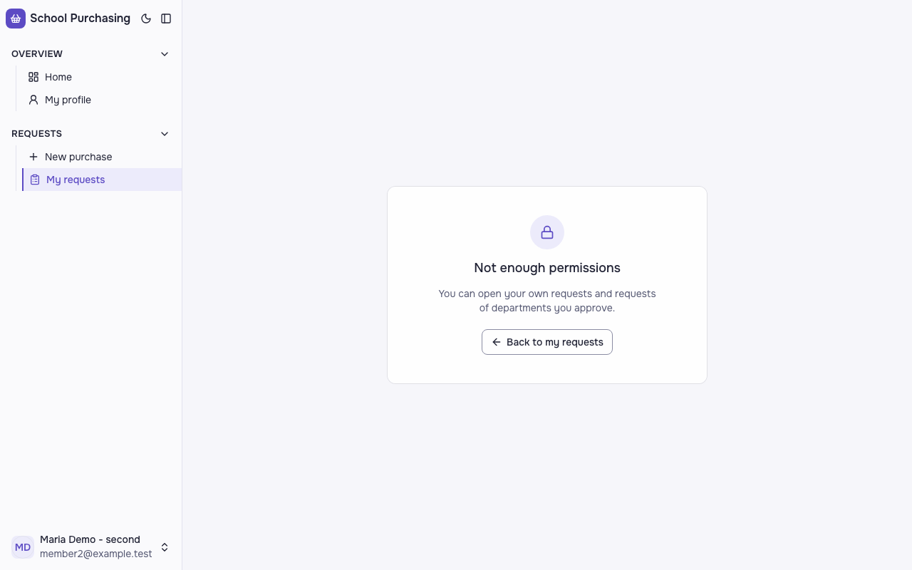
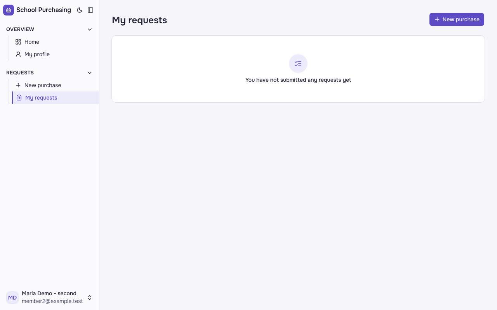
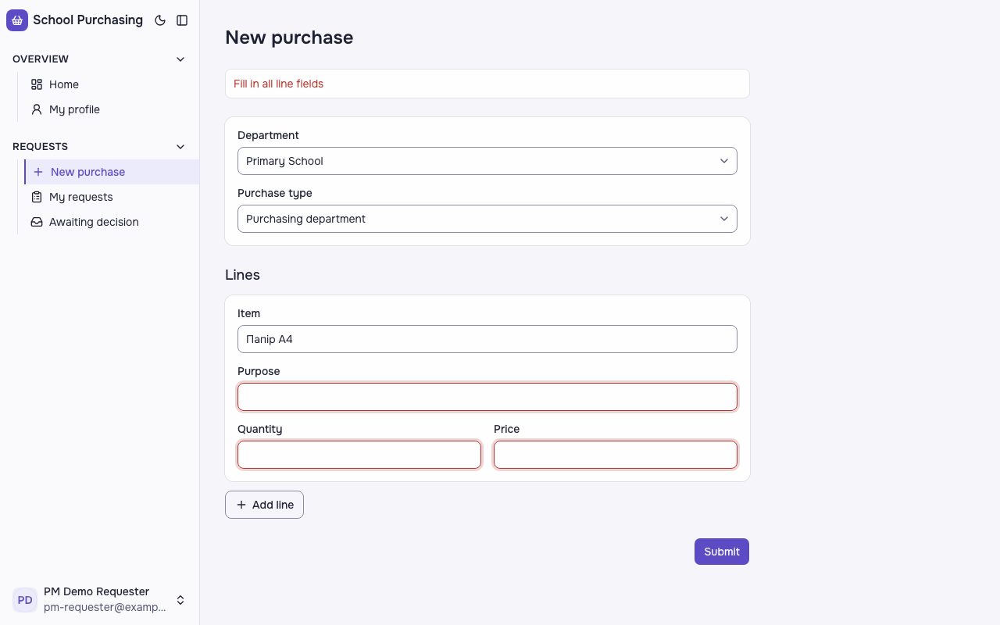

# Звіт UAT — 03.11.2026

- **Застосунок:** https://therapy-scheduling-ten.vercel.app (/api/health: коміт `152825c`)
- **Код тестів:** `task/uat` @ `6035e9e` + незакомічені зміни
- **Прогін:** 03.11.2026, 13:47 (Київ), Playwright 29.3 с; AC: 3 — PASS 3, FAIL 0, NEEDS-HUMAN 0
- **Рецензент:** `claude-haiku-5-5`; суперечки → `claude-sonnet-5-5`. Разом за розбір: $0.0968 (ціни API; за підпискою — у межах ліміту плану)
- **Прибирання:** синтетичних uat-*@example.test видалено 0, лишилось 0, їхніх рядків, що лишились: 0
- **Відео й траси:** не в git — `test-results/` локально або артефакт CI; трасу відкриває `npx playwright show-trace <trace.zip>`

| AC | Перевірки | Агент | Підсумок | Чому | Playwright | Розбір |
|---|---|---|---|---|---|---|
| AC-FRM-08 | пройшли | Haiku: NEEDS-HUMAN, Sonnet: PASS | **PASS** | R6: перевірки, агент і цитати збігаються | 5.7 с | $0.0330, 22.0 с |
| AC-FRM-14 | пройшли | Haiku: NEEDS-HUMAN, Sonnet: PASS | **PASS** | R6: перевірки, агент і цитати збігаються | 3.0 с | $0.0324, 25.6 с |
| AC-FRM-15 | пройшли | Haiku: FAIL, Sonnet: PASS | **PASS** | R6: перевірки, агент і цитати збігаються | 10.0 с | $0.0313, 14.2 с |

## AC-FRM-08 — PASS

**Тест:** AC-FRM-08: заявник того ж відділу відкриває чужу закупівлю за прямим посиланням — «Not enough permissions», даних не показано, статус не змінився

**Критерій** (requirements/47-pratsivnyk-podaie-zakupivliu-cherez-formu.md):

> AC-FRM-08: Дано працівник 1 подав закупівлю у відділ «Початкова школа», а працівник 2 — заявник того ж відділу, не автор і не схвалювач. Коли працівник 2 відкриває закупівлю працівника 1 за прямим посиланням. Тоді він бачить повідомлення «Недостатньо прав», даних закупівлі йому не показано, а закупівля працівника 1 лишається зі статусом «Очікує схвалення».

**Кроки:** ✔ Дано: працівник 1 подав закупівлю у відділ «Початкова школа», а працівник 2 — заявник того ж відділу, не автор і не схвалювач → ✔ Коли: працівник 2 відкриває закупівлю працівника 1 за прямим посиланням → ✔ Тоді: він бачить повідомлення «Недостатньо прав», даних закупівлі йому не показано, а закупівля працівника 1 лишається зі статусом «Очікує схвалення».

**Агент (claude-sonnet-5-5, PASS):** На кадрі по центру картка із замком і заголовком «Not enough permissions», поясненням і кнопкою «Back to my requests». Рядків закупівлі, суми чи автора не видно. Користувач — member2@example.test.

Haiku сказав NEEDS-HUMAN, тож розбір повторив Sonnet; рішення агента — за Sonnet.

**Цитати агента, звірені зі сторінкою (aria):**
- «Not enough permissions» — є на сторінці
- «You can open your own requests and requests of departments you approve.» — є на сторінці

**Правило:** R6: перевірки, агент і цитати збігаються

**Відео:** `test-results/artifacts/purchase-працівник-2-3-mem-c3eff-показано-статус-не-змінився-chromium/video.webm` · **траса:** `test-results/artifacts/purchase-працівник-2-3-mem-c3eff-показано-статус-не-змінився-chromium/trace.zip` (не в git)

**Рішення PM:** ☐ приймаю · ☐ відхилення від вимог (issue «Відхилення від вимог: AC-FRM-08 — …») · @login: ____

## AC-FRM-14 — PASS

**Тест:** AC-FRM-14: працівник без жодної поданої заявки відкриває «My requests» — «You have not submitted any requests yet», списку немає

**Критерій** (requirements/47-pratsivnyk-podaie-zakupivliu-cherez-formu.md):

> AC-FRM-14: Дано працівник 3 без жодної поданої заявки. Коли він відкриває сторінку «Мої заявки». Тоді він бачить повідомлення «Ви ще не подали жодної заявки», а списку заявок немає.

**Кроки:** ✔ Дано: працівник 3 без жодної поданої заявки → ✔ Коли: він відкриває сторінку «Мої заявки» → ✔ Тоді: він бачить повідомлення «Ви ще не подали жодної заявки», а списку заявок немає.

**Агент (claude-sonnet-5-5, PASS):** На кадрі сторінка з заголовком «My requests» і порожнім станом з написом «You have not submitted any requests yet». Таблиці чи рядків заявок не видно. Частину «Не з кадрів» не оцінював.

Haiku сказав NEEDS-HUMAN, тож розбір повторив Sonnet; рішення агента — за Sonnet.

**Цитати агента, звірені зі сторінкою (aria):**
- «My requests» — є на сторінці
- «You have not submitted any requests yet» — є на сторінці
- «You have not submitted any requests yet» — є на сторінці

**Правило:** R6: перевірки, агент і цитати збігаються

**Відео:** `test-results/artifacts/purchase-працівник-2-3-mem-1b8f1--requests-yet»-списку-немає-chromium/video.webm` · **траса:** `test-results/artifacts/purchase-працівник-2-3-mem-1b8f1--requests-yet»-списку-немає-chromium/trace.zip` (не в git)

**Рішення PM:** ☐ приймаю · ☐ відхилення від вимог (issue «Відхилення від вимог: AC-FRM-14 — …») · @login: ____

## AC-FRM-15 — PASS

**Тест:** AC-FRM-15: рядок лише з назвою «Папір А4» — «Fill in all line fields», закупівлю не подано

**Критерій** (requirements/47-pratsivnyk-podaie-zakupivliu-cherez-formu.md):

> AC-FRM-15: Дано працівник 1 обрав відділ «Початкова школа», тип «Відділ закупівель» і додав рядок лише з назвою «Папір А4», без мети, кількості й ціни. Коли він намагається подати закупівлю. Тоді він бачить повідомлення «Заповніть усі поля рядка», а закупівлю не подано.

**Кроки:** ✔ Дано: працівник 1 обрав відділ «Початкова школа», тип «Відділ закупівель» і додав рядок лише з назвою «Папір А4», без мети, кількості й ціни → ✔ Коли: він намагається подати закупівлю → ✔ Тоді: він бачить повідомлення «Заповніть усі поля рядка», а закупівлю не подано.

**Агент (claude-sonnet-5-5, PASS):** На кадрі сторінка «New purchase» із червоним повідомленням «Fill in all line fields» над формою. Поле Item містить «Папір А4», а поля Purpose, Quantity і Price порожні та підсвічені червоним.

Haiku сказав FAIL, тож розбір повторив Sonnet; рішення агента — за Sonnet.

**Цитати агента, звірені зі сторінкою (aria):**
- «Fill in all line fields» — є на сторінці
- «New purchase» — є на сторінці
- «Папір А4» — є на сторінці

**Правило:** R6: перевірки, агент і цитати збігаються

**Відео:** `test-results/artifacts/purchase-працівник-1-pm-re-000b0-fields»-закупівлю-не-подано-chromium/video.webm` · **траса:** `test-results/artifacts/purchase-працівник-1-pm-re-000b0-fields»-закупівлю-не-подано-chromium/trace.zip` (не в git)

**Рішення PM:** ☐ приймаю · ☐ відхилення від вимог (issue «Відхилення від вимог: AC-FRM-15 — …») · @login: ____

## Як читати підсумок

- **PASS** — автоматичні перевірки пройшли, агент-рецензент погодився з кадром, а кожну його цитату знайдено на сторінці.
- **FAIL** — впала автоматична перевірка. Агент цього не перекриває: невидимі вади (буфер обміну, база) він на кадрі не побачить.
- **NEEDS-HUMAN** — перевірки зелені, але агент не погодився або його цитати немає на сторінці. Часто це слабкий тест або розбіжність між текстом AC і тестом — питання до PM, а не обов'язково вада продукту.

Правила: R1: перевірка впала — FAIL завжди, агент не перекриває; R2: немає вердикту агента або кадру; R3: перевірки пройшли, агент не погоджується — вирішує людина; R4: цитати агента немає на сторінці (aria) — не підтверджено; R5: помилка сторінки або 5xx під час сценарію; R6: перевірки, агент і цитати збігаються.
