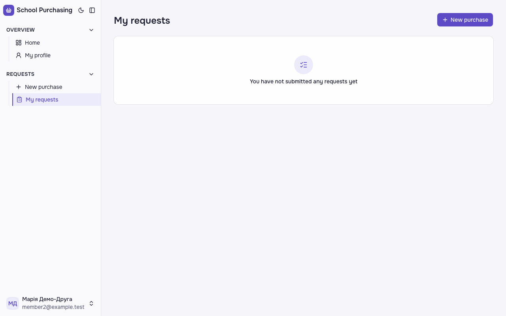
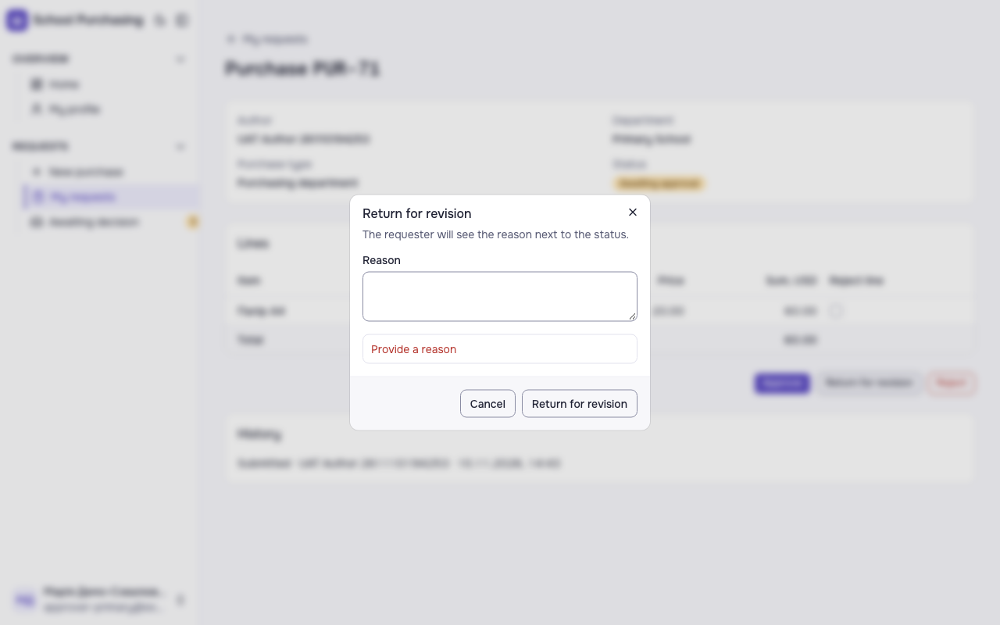

# Звіт UAT — 10.11.2026

- **Застосунок:** https://therapy-scheduling-ten.vercel.app (/api/health: коміт `a93232b`)
- **Код тестів:** `task/uat-slice3` @ `74bf2e1`
- **Прогін:** 10.11.2026, 21:42 (Київ), Playwright 54.2 с; AC: 0 — PASS 0, FAIL 0, NEEDS-HUMAN 0; негативних контролів: 3
- **Рецензент:** `claude-haiku-5-5`; суперечки → `claude-sonnet-5-5`. Разом за розбір: $0.0377 (ціни API; за підпискою — у межах ліміту плану)
- **Прибирання:** синтетичних uat-*@example.test видалено 1, лишилось 0, їхніх рядків, що лишились: 0
- **Відео й траси:** не в git — `test-results/` локально або артефакт CI; трасу відкриває `npx playwright show-trace <trace.zip>`

| AC | Перевірки | Агент | Підсумок | Чому | Playwright | Розбір |
|---|---|---|---|---|---|---|
| NC-1 (AC-FRM-14) | впали | Haiku: NEEDS-HUMAN | **FAIL** | R1: перевірка впала — FAIL завжди, агент не перекриває | 8.6 с | $0.0023, 10.5 с |
| NC-2 (AC-FRM-14) | пройшли | Haiku: FAIL, Sonnet: FAIL | **NEEDS-HUMAN** | R3: перевірки пройшли, агент не погоджується — вирішує людина | 4.1 с | $0.0333, 17.9 с |
| NC-3 (AC-DEC-06) | впали | Haiku: NEEDS-HUMAN | **FAIL** | R1: перевірка впала — FAIL завжди, агент не перекриває | 14.5 с | $0.0022, 10.2 с |

## NC-1 — негативний контроль для AC-FRM-14 — FAIL

**Тест:** NC-1 (AC-FRM-14, навмисно хибне очікування в тесті: інший текст порожнього стану)

**Критерій** (requirements/47-pratsivnyk-podaie-zakupivliu-cherez-formu.md):

> AC-FRM-14: Дано працівник 3 без жодної заявки. Коли він відкриває сторінку «Мої заявки». Тоді він бачить повідомлення «Ви ще не подали жодної заявки», а списку заявок немає.



**Кроки:** ✔ Дано: працівник 3 без жодної поданої заявки → ✔ Коли: він відкриває сторінку «Мої заявки» → ✘ Тоді: він бачить повідомлення «Ви ще не подали жодної заявки», а списку заявок немає.

**Перевірка впала:**

```
Error: expect(locator).toHaveText(expected) failed

Locator:  getByTestId('no-requests')
Expected: "You have no requests yet"
Received: "You have not submitted any requests yet"
Timeout:  5000ms

Call log:
```

**Агент (claude-haiku-5-5, NEEDS-HUMAN):** На кадрі сторінка «My requests» з порожнім станом: білий блок з іконкою і текстом «You have not submitted any requests yet», без таблиці чи рядків заявок. Обидві видимі частини з ac.md збігаються посимвольно з кадром. Вердикт NEEDS-HUMAN, бо критерій у тексті «Тоді» вимагає українського повідомлення «Ви ще не подали жодної заявки», а на екрані англійська; це треба вирішити PM, а не мені.

**Агент бачить вади:**
- Розбіжність з критерієм: у ac.md текст «Тоді» дослівно звучить «Ви ще не подали жодної заявки» (українською), а на кадрі повідомлення англійською: «You have not submitted any requests yet». Список видимих частин у ac.md також містить англійський текст, тому з ним кадр збігається, але литерально текст критерію на екрані не відтворено. Потрібне рішення PM: яка мова повідомлення є правильною.

**Цитати агента, звірені зі сторінкою (aria):**
- «My requests» — є на сторінці
- «You have not submitted any requests yet» — є на сторінці

**Правило:** R1: перевірка впала — FAIL завжди, агент не перекриває

**Відео:** `test-results/artifacts/negative-controls-NC-1-AC--aa8a2-ший-текст-порожнього-стану--negative-controls/video.webm` · **траса:** `test-results/artifacts/negative-controls-NC-1-AC--aa8a2-ший-текст-порожнього-стану--negative-controls/trace.zip` (не в git)

_Негативний контроль: навмисно хибне очікування. Очікуваний підсумок — FAIL або NEEDS-HUMAN, не PASS._

## NC-2 — негативний контроль для AC-FRM-14 — NEEDS-HUMAN

**Тест:** NC-2 (AC-FRM-14, текст «Тоді» у вимозі змінено, тест і застосунок — ні)

**Критерій** (анотація ac-text у тесті (негативний контроль)):

> AC-FRM-14: Дано працівник 3 без жодної поданої заявки. Коли він відкриває сторінку «Мої заявки». Тоді він бачить повідомлення «You have no requests yet» і кнопку «Create your first request», а списку заявок немає.


**Кроки:** ✔ Дано: працівник 3 без жодної поданої заявки → ✔ Коли: він відкриває сторінку «Мої заявки» → ✔ Тоді: він бачить повідомлення «Ви ще не подали жодної заявки», а списку заявок немає.

**Агент (claude-sonnet-5-5, FAIL):** На кадрі сторінка «My requests» із порожнім станом «You have not submitted any requests yet». Кнопки «Create your first request» немає, лише «New purchase». Через відсутню кнопку критерій не виконано.

Haiku сказав FAIL, тож розбір повторив Sonnet; рішення агента — за Sonnet.

**Агент бачить вади:**
- Кнопки «Create your first request» на кадрі немає; є лише кнопка «New purchase» угорі праворуч.
- Текст повідомлення на кадрі («You have not submitted any requests yet») відрізняється від тексту в самому критерії («You have no requests yet»); перевірочний перелік у ac.md містить текст з кадру.
- На кадрі в профілі видно member2@example.test (Марія Демо-Друга), що не підтверджує, що це «працівник 3».

**Цитати агента, звірені зі сторінкою (aria):**
- «My requests» — є на сторінці
- «You have not submitted any requests yet» — є на сторінці

**Правило:** R3: перевірки пройшли, агент не погоджується — вирішує людина

**Відео:** `test-results/artifacts/negative-controls-NC-2-AC--1d6b3-ено-тест-і-застосунок-—-ні--negative-controls/video.webm` · **траса:** `test-results/artifacts/negative-controls-NC-2-AC--1d6b3-ено-тест-і-застосунок-—-ні--negative-controls/trace.zip` (не в git)

_Негативний контроль: навмисно хибне очікування. Очікуваний підсумок — FAIL або NEEDS-HUMAN, не PASS._

## NC-3 — негативний контроль для AC-DEC-06 — FAIL

**Тест:** NC-3 (AC-DEC-06, навмисно хибне очікування в тесті: інший текст відмови)

**Критерій** (requirements/63-skhvaliuvach-chastkovo-skhvaliuie.md):

> AC-DEC-06: Дано заявка відділу «Початкова школа» зі статусом «Очікує схвалення», Марія схвалює цей відділ. Коли Марія повертає заявку на доопрацювання без причини. Тоді вона бачить повідомлення «Вкажіть причину», а статус заявки лишається «Очікує схвалення».



**Кроки:** ✔ Дано: заявка відділу «Початкова школа» зі статусом «Очікує схвалення», Марія схвалює цей відділ → ✔ Коли: Марія повертає заявку на доопрацювання без причини → ✘ Тоді: вона бачить повідомлення «Вкажіть причину», а статус заявки лишається «Очікує схвалення».

**Перевірка впала:**

```
Error: expect(locator).toHaveText(expected) failed

Locator:  getByRole('dialog').getByRole('alert')
Expected: "Enter the reason"
Received: "Provide a reason"
Timeout:  5000ms

Call log:
```

**Агент (claude-haiku-5-5, NEEDS-HUMAN):** На кадрі видно діалог «Return for revision» з порожнім полем «Reason» і червоним написом «Provide a reason» під ним; фон розмитий. Напис точно збігається з переліком видимих частин, але не з текстом «Вкажіть причину» в основному критерії, тому рішення залишаю за людиною. Статус «Очікує схвалення» на фоні розмитий і не читається, але в переліку видимих частин його немає.

**Агент бачить вади:**
- Розбіжність у самому критерії: основний текст AC-DEC-06 очікує повідомлення «Вкажіть причину», а перелік видимих частин «Тоді» — «Provide a reason». На кадрі видно саме «Provide a reason», тож за переліком частина виконана, але за основним текстом критерію — ні. PM має уточнити, який текст правильний.

**Цитати агента, звірені зі сторінкою (aria):**
- «Provide a reason» — є на сторінці

**Правило:** R1: перевірка впала — FAIL завжди, агент не перекриває

**Відео:** `test-results/artifacts/negative-controls-зріз-3-N-fc950--тесті-інший-текст-відмови--negative-controls/video.webm` · **траса:** `test-results/artifacts/negative-controls-зріз-3-N-fc950--тесті-інший-текст-відмови--negative-controls/trace.zip` (не в git)

_Негативний контроль: навмисно хибне очікування. Очікуваний підсумок — FAIL або NEEDS-HUMAN, не PASS._

## Як читати підсумок

- **PASS** — автоматичні перевірки пройшли, агент-рецензент погодився з кадром, а кожну його цитату знайдено на сторінці.
- **FAIL** — впала автоматична перевірка. Агент цього не перекриває: невидимі вади (буфер обміну, база) він на кадрі не побачить.
- **NEEDS-HUMAN** — перевірки зелені, але агент не погодився або його цитати немає на сторінці. Часто це слабкий тест або розбіжність між текстом AC і тестом — питання до PM, а не обов'язково вада продукту.

Правила: R1: перевірка впала — FAIL завжди, агент не перекриває; R2: немає вердикту агента або кадру; R3: перевірки пройшли, агент не погоджується — вирішує людина; R4: цитати агента немає на сторінці (aria) — не підтверджено; R5: помилка сторінки або 5xx під час сценарію; R6: перевірки, агент і цитати збігаються.
