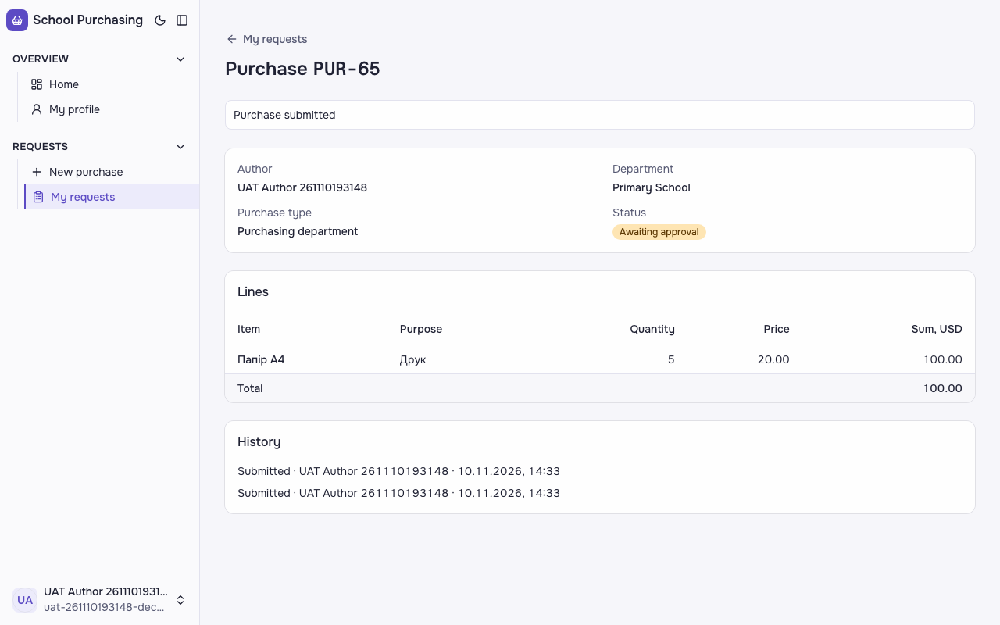
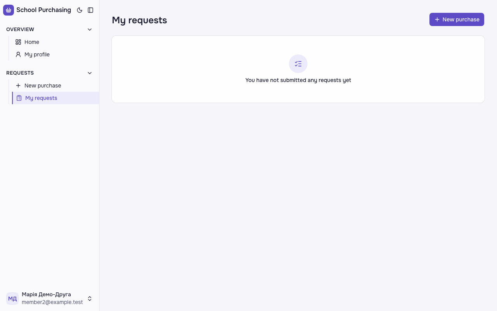
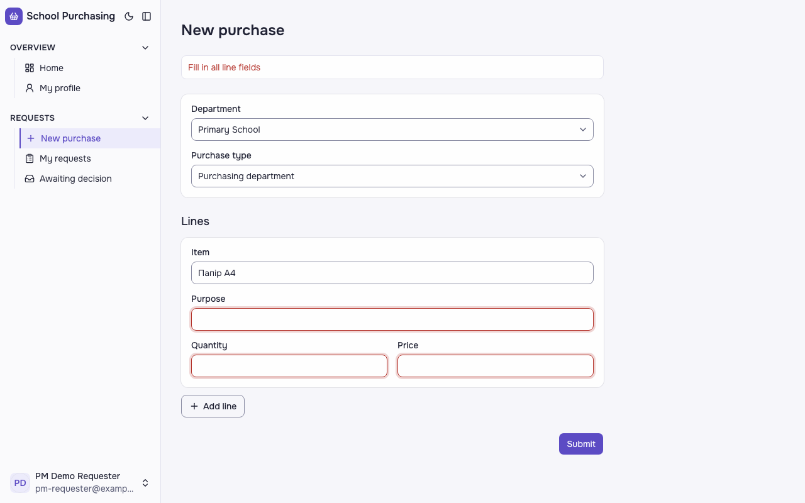

# Звіт UAT — 10.11.2026

- **Застосунок:** https://therapy-scheduling-ten.vercel.app (/api/health: коміт `a93232b`)
- **Код тестів:** `task/uat-slice3` @ `b1bb4a8`
- **Прогін:** 10.11.2026, 21:31 (Київ), Playwright 198.4 с; AC: 12 — PASS 12, FAIL 0, NEEDS-HUMAN 0
- **Рецензент:** `claude-haiku-5-5`; суперечки → `claude-sonnet-5-5`. Разом за розбір: $0.2570 (ціни API; за підпискою — у межах ліміту плану)
- **Прибирання:** синтетичних uat-*@example.test видалено 9, лишилось 0, їхніх рядків, що лишились: 0
- **Відео й траси:** не в git — `test-results/` локально або артефакт CI; трасу відкриває `npx playwright show-trace <trace.zip>`

| AC | Перевірки | Агент | Підсумок | Чому | Playwright | Розбір |
|---|---|---|---|---|---|---|
| AC-DEC-01 | пройшли | Haiku: PASS | **PASS** | R6: перевірки, агент і цитати збігаються | 19.2 с | $0.0028, 11.6 с |
| AC-DEC-04 | пройшли | Haiku: FAIL, Sonnet: PASS | **PASS** | R6: перевірки, агент і цитати збігаються | 14.4 с | $0.0394, 14.4 с |
| AC-DEC-06 | пройшли | Haiku: NEEDS-HUMAN, Sonnet: PASS | **PASS** | R6: перевірки, агент і цитати збігаються | 11.1 с | $0.0404, 20.5 с |
| AC-DEC-07 | пройшли | Haiku: PASS | **PASS** | R6: перевірки, агент і цитати збігаються | 20.0 с | $0.0021, 8.8 с |
| AC-FRM-08 | пройшли | Haiku: FAIL, Sonnet: PASS | **PASS** | R6: перевірки, агент і цитати збігаються | 7.5 с | $0.0323, 15.0 с |
| AC-FRM-14 | пройшли | Haiku: FAIL, Sonnet: PASS | **PASS** | R6: перевірки, агент і цитати збігаються | 3.2 с | $0.0336, 19.6 с |
| AC-FRM-15 | пройшли | Haiku: FAIL, Sonnet: PASS | **PASS** | R6: перевірки, агент і цитати збігаються | 10.9 с | $0.0363, 20.6 с |
| AC-HIST-01 | пройшли | Haiku: PASS | **PASS** | R6: перевірки, агент і цитати збігаються | 25.5 с | $0.0021, 8.5 с |
| AC-HIST-02 | пройшли | Haiku: PASS | **PASS** | R6: перевірки, агент і цитати збігаються | 8.1 с | $0.0019, 7.4 с |
| AC-HIST-06 | пройшли | Haiku: FAIL, Sonnet: PASS | **PASS** | R6: перевірки, агент і цитати збігаються | 7.5 с | $0.0316, 19.0 с |
| AC-HIST-10 | пройшли | Haiku: FAIL, Sonnet: PASS | **PASS** | R6: перевірки, агент і цитати збігаються | 5.8 с | $0.0319, 19.0 с |
| AC-LANG-09 | пройшли | Haiku: PASS | **PASS** | R6: перевірки, агент і цитати збігаються | 23.5 с | $0.0025, 9.7 с |

## AC-DEC-01 — PASS

**Тест:** AC-DEC-01: Марія відхиляє рядок 2 і схвалює — «Partially approved», рядок 2 «Rejected», рядки 1 і 3 «Approved»

**Критерій** (requirements/63-skhvaliuvach-chastkovo-skhvaliuie.md):

> AC-DEC-01: Дано заявка відділу «Початкова школа» з трьома рядками зі статусом «Очікує схвалення», автор — не Марія, Марія схвалює цей відділ. Коли Марія відхиляє рядок 2 і схвалює заявку. Тоді статус заявки «Частково схвалено», автор бачить рядок 2 зі статусом «Відхилено», а рядки 1 і 3 — зі статусом «Схвалено».

**Кроки:** ✔ Дано: заявка відділу «Початкова школа» з трьома рядками зі статусом «Очікує схвалення», автор — не Марія, Марія схвалює цей відділ → ✔ Коли: Марія відхиляє рядок 2 і схвалює заявку → ✔ Тоді: статус заявки «Частково схвалено», автор бачить рядок 2 зі статусом «Відхилено», а рядки 1 і 3 — зі статусом «Схвалено».

**Агент (claude-haiku-5-5, PASS):** На кадрі сторінка «Purchase PUR-60» з бейджем статусу «Partially approved», у таблиці Lines рядок «Папір А4» має «Approved», «Маркери» — «Rejected», «Зошити» — «Approved». Вердикт PASS за переліком видимих частин з ac.md. Зверни увагу: сам критерій написано українською («Частково схвалено», «Схвалено», «Відхилено»), а інтерфейс на кадрі англійський; я звіряв із англійськими написами, як це вказано в ac.md, тому якщо локалізація мала бути українською, рецензент-людина має підтвердити окремо.

**Цитати агента, звірені зі сторінкою (aria):**
- «Partially approved» — є на сторінці
- «Маркери» — є на сторінці
- «Rejected» — є на сторінці
- «Папір А4» — є на сторінці
- «Approved» — є на сторінці
- «Зошити» — є на сторінці
- «Approved» — є на сторінці

**Правило:** R6: перевірки, агент і цитати збігаються

**Відео:** `test-results/artifacts/purchase-history-схвалювач-28bc5-ted»-рядки-1-і-3-«Approved»-chromium/video.webm` · **траса:** `test-results/artifacts/purchase-history-схвалювач-28bc5-ted»-рядки-1-і-3-«Approved»-chromium/trace.zip` (не в git)

**Рішення PM:** ☐ приймаю · ☐ відхилення від вимог (issue «Відхилення від вимог: AC-DEC-01 — …») · @login: ____

## AC-DEC-04 — PASS

**Тест:** AC-DEC-04: Марія повертає заявку з причиною «Уточніть кількість» — «Returned for revision»

**Критерій** (requirements/63-skhvaliuvach-chastkovo-skhvaliuie.md):

> AC-DEC-04: Дано заявка відділу «Початкова школа» зі статусом «Очікує схвалення», автор — не Марія, Марія схвалює цей відділ. Коли Марія повертає заявку на доопрацювання з причиною «Уточніть кількість». Тоді статус заявки «Повернено на доопрацювання».

**Кроки:** ✔ Дано: заявка відділу «Початкова школа» зі статусом «Очікує схвалення», автор — не Марія, Марія схвалює цей відділ → ✔ Коли: Марія повертає заявку на доопрацювання з причиною «Уточніть кількість» → ✔ Тоді: статус заявки «Повернено на доопрацювання».

**Агент (claude-sonnet-5-5, PASS):** На сторінці Purchase PUR-61 поле Status показує бейдж «Returned for revision», а поле Return reason — «Уточніть кількість». Відділ Primary School, автор — UAT Author, що відповідає критерію.

Haiku сказав FAIL, тож розбір повторив Sonnet; рішення агента — за Sonnet.

**Цитати агента, звірені зі сторінкою (aria):**
- «Returned for revision» — є на сторінці
- «Уточніть кількість» — є на сторінці

**Правило:** R6: перевірки, агент і цитати збігаються

**Відео:** `test-results/artifacts/purchase-history-схвалювач-f1372-»-—-«Returned-for-revision»-chromium/video.webm` · **траса:** `test-results/artifacts/purchase-history-схвалювач-f1372-»-—-«Returned-for-revision»-chromium/trace.zip` (не в git)

**Рішення PM:** ☐ приймаю · ☐ відхилення від вимог (issue «Відхилення від вимог: AC-DEC-04 — …») · @login: ____

## AC-DEC-06 — PASS

**Тест:** AC-DEC-06: повернення без причини — «Provide a reason», статус лишається «Awaiting approval»

**Критерій** (requirements/63-skhvaliuvach-chastkovo-skhvaliuie.md):

> AC-DEC-06: Дано заявка відділу «Початкова школа» зі статусом «Очікує схвалення», Марія схвалює цей відділ. Коли Марія повертає заявку на доопрацювання без причини. Тоді вона бачить повідомлення «Вкажіть причину», а статус заявки лишається «Очікує схвалення».

**Кроки:** ✔ Дано: заявка відділу «Початкова школа» зі статусом «Очікує схвалення», Марія схвалює цей відділ → ✔ Коли: Марія повертає заявку на доопрацювання без причини → ✔ Тоді: вона бачить повідомлення «Вкажіть причину» → ✔ Тоді: а статус заявки лишається «Очікує схвалення».

**Агент (claude-sonnet-5-5, PASS):** На першому кадрі відкритий діалог «Return for revision» з порожнім полем Reason і червоним повідомленням «Provide a reason». На другому кадрі сторінка PUR-62 має статус «Awaiting approval».

Haiku сказав NEEDS-HUMAN, тож розбір повторив Sonnet; рішення агента — за Sonnet.

**Цитати агента, звірені зі сторінкою (aria):**
- «Return for revision» — є на сторінці
- «Provide a reason» — є на сторінці
- «Status» — є на сторінці
- «Awaiting approval» — є на сторінці

**Правило:** R6: перевірки, агент і цитати збігаються

**Відео:** `test-results/artifacts/purchase-history-схвалювач-d7d6c-шається-«Awaiting-approval»-chromium/video.webm` · **траса:** `test-results/artifacts/purchase-history-схвалювач-d7d6c-шається-«Awaiting-approval»-chromium/trace.zip` (не в git)

**Рішення PM:** ☐ приймаю · ☐ відхилення від вимог (issue «Відхилення від вимог: AC-DEC-06 — …») · @login: ____

## AC-DEC-07 — PASS

**Тест:** AC-DEC-07: автор виправив рядок 1 поверненої заявки й подав знову — «Awaiting approval», відділ той самий

**Критерій** (requirements/63-skhvaliuvach-chastkovo-skhvaliuie.md):

> AC-DEC-07: Дано заявка зі статусом «Повернено на доопрацювання», автор виправив рядок 1. Коли автор подає заявку знову. Тоді статус заявки «Очікує схвалення», відділ той самий.

**Кроки:** ✔ Дано: заявка зі статусом «Повернено на доопрацювання», автор виправив рядок 1 → ✔ Коли: автор подає заявку знову → ✔ Тоді: статус заявки «Очікує схвалення», відділ той самий.

**Агент (claude-haiku-5-5, PASS):** На кадрі сторінка заявки PUR-65: статус «Awaiting approval», відділ «Primary School», у рядку «Папір А4» кількість 5. Усі три видимі частини «Тоді» збігаються з критерієм. В історії видно два однакових записи «Submitted» з одним часом, це не суперечить критерію, але варто глянути окремо. Слово «(виправлено)» з ac.md на екрані не відображається — це позначка для рецензента, тому оцінювалися лише текст і цифри на кадрі.

**Цитати агента, звірені зі сторінкою (aria):**
- «Awaiting approval» — є на сторінці
- «Primary School» — є на сторінці
- «Папір А4» — є на сторінці
- «5» — є на сторінці

**Правило:** R6: перевірки, агент і цитати збігаються

**Відео:** `test-results/artifacts/purchase-history-синтетичн-f18ee--approval»-відділ-той-самий-chromium/video.webm` · **траса:** `test-results/artifacts/purchase-history-синтетичн-f18ee--approval»-відділ-той-самий-chromium/trace.zip` (не в git)

**Рішення PM:** ☐ приймаю · ☐ відхилення від вимог (issue «Відхилення від вимог: AC-DEC-07 — …») · @login: ____

## AC-FRM-08 — PASS

**Тест:** AC-FRM-08: заявник того ж відділу відкриває чужу закупівлю за прямим посиланням — «Not enough permissions», даних не показано, статус не змінився

**Критерій** (requirements/47-pratsivnyk-podaie-zakupivliu-cherez-formu.md):

> AC-FRM-08: Дано працівник 1 подав закупівлю у відділ «Початкова школа», а працівник 2 — заявник того ж відділу, не автор і не схвалювач. Коли працівник 2 відкриває закупівлю працівника 1 за прямим посиланням. Тоді він бачить повідомлення «Недостатньо прав», даних закупівлі йому не показано, а закупівля працівника 1 лишається зі статусом «Очікує схвалення».

**Кроки:** ✔ Дано: працівник 1 подав закупівлю у відділ «Початкова школа», а працівник 2 — заявник того ж відділу, не автор і не схвалювач → ✔ Коли: працівник 2 відкриває закупівлю працівника 1 за прямим посиланням → ✔ Тоді: він бачить повідомлення «Недостатньо прав», даних закупівлі йому не показано, а закупівля працівника 1 лишається зі статусом «Очікує схвалення».

**Агент (claude-sonnet-5-5, PASS):** На кадрі по центру лише картка відмови із заголовком «Not enough permissions», поясненням і кнопкою «Back to my requests». Рядків закупівлі, суми чи автора не видно. Частини «Не з кадрів» не оцінювалися.

Haiku сказав FAIL, тож розбір повторив Sonnet; рішення агента — за Sonnet.

**Цитати агента, звірені зі сторінкою (aria):**
- «Not enough permissions» — є на сторінці
- «You can open your own requests and requests of departments you approve.» — є на сторінці

**Правило:** R6: перевірки, агент і цитати збігаються

**Відео:** `test-results/artifacts/purchase-працівник-2-pm-re-75e54-показано-статус-не-змінився-chromium/video.webm` · **траса:** `test-results/artifacts/purchase-працівник-2-pm-re-75e54-показано-статус-не-змінився-chromium/trace.zip` (не в git)

**Рішення PM:** ☐ приймаю · ☐ відхилення від вимог (issue «Відхилення від вимог: AC-FRM-08 — …») · @login: ____

## AC-FRM-14 — PASS

**Тест:** AC-FRM-14: працівник без жодної поданої заявки відкриває «My requests» — «You have not submitted any requests yet», списку немає

**Критерій** (requirements/47-pratsivnyk-podaie-zakupivliu-cherez-formu.md):

> AC-FRM-14: Дано працівник 3 без жодної заявки. Коли він відкриває сторінку «Мої заявки». Тоді він бачить повідомлення «Ви ще не подали жодної заявки», а списку заявок немає.

**Кроки:** ✔ Дано: працівник 3 без жодної поданої заявки → ✔ Коли: він відкриває сторінку «Мої заявки» → ✔ Тоді: він бачить повідомлення «Ви ще не подали жодної заявки», а списку заявок немає.

**Агент (claude-sonnet-5-5, PASS):** На кадрі сторінка з заголовком «My requests» і порожнім станом із текстом «You have not submitted any requests yet», списку не видно. У бічній панелі показано користувача member2@example.test (Марія Демо-Друга); з кадру не можна зіставити його з «працівником 3», але це не входить до перелічених частин.

Haiku сказав FAIL, тож розбір повторив Sonnet; рішення агента — за Sonnet.

**Цитати агента, звірені зі сторінкою (aria):**
- «My requests» — є на сторінці
- «You have not submitted any requests yet» — є на сторінці

**Правило:** R6: перевірки, агент і цитати збігаються

**Відео:** `test-results/artifacts/purchase-працівник-3-membe-b1424--requests-yet»-списку-немає-chromium/video.webm` · **траса:** `test-results/artifacts/purchase-працівник-3-membe-b1424--requests-yet»-списку-немає-chromium/trace.zip` (не в git)

**Рішення PM:** ☐ приймаю · ☐ відхилення від вимог (issue «Відхилення від вимог: AC-FRM-14 — …») · @login: ____

## AC-FRM-15 — PASS

**Тест:** AC-FRM-15: рядок лише з назвою «Папір А4» — «Fill in all line fields», закупівлю не подано

**Критерій** (requirements/47-pratsivnyk-podaie-zakupivliu-cherez-formu.md):

> AC-FRM-15: Дано працівник 1 обрав відділ «Початкова школа», тип «Відділ закупівель» і додав рядок лише з назвою «Папір А4», без мети, кількості й ціни. Коли він намагається подати закупівлю. Тоді він бачить повідомлення «Заповніть усі поля рядка», а закупівлю не подано.

**Кроки:** ✔ Дано: працівник 1 обрав відділ «Початкова школа», тип «Відділ закупівель» і додав рядок лише з назвою «Папір А4», без мети, кількості й ціни → ✔ Коли: він намагається подати закупівлю → ✔ Тоді: він бачить повідомлення «Заповніть усі поля рядка», а закупівлю не подано.

**Агент (claude-sonnet-5-5, PASS):** На кадрі сторінка «New purchase» з червоним повідомленням «Fill in all line fields» над формою. У полі Item лишається «Папір А4», а поля Purpose, Quantity і Price порожні та підсвічені червоним. Інтерфейс англомовний, а критерій у PM українською; я звірив із англійським текстом із переліку частин у ac.md.

Haiku сказав FAIL, тож розбір повторив Sonnet; рішення агента — за Sonnet.

**Цитати агента, звірені зі сторінкою (aria):**
- «Fill in all line fields» — є на сторінці
- «New purchase» — є на сторінці
- «Папір А4» — є на сторінці

**Правило:** R6: перевірки, агент і цитати збігаються

**Відео:** `test-results/artifacts/purchase-працівник-1-pm-re-000b0-fields»-закупівлю-не-подано-chromium/video.webm` · **траса:** `test-results/artifacts/purchase-працівник-1-pm-re-000b0-fields»-закупівлю-не-подано-chromium/trace.zip` (не в git)

**Рішення PM:** ☐ приймаю · ☐ відхилення від вимог (issue «Відхилення від вимог: AC-FRM-15 — …») · @login: ____

## AC-HIST-01 — PASS

**Тест:** AC-HIST-01: працівник 1 подає дві закупівлі — у «My requests» номери PUR-n і PUR-(n+1)

**Критерій** (requirements/64-zaiavka-maie-nomer-sumy-riadkiv.md):

> AC-HIST-01: Дано в системі ще немає жодної закупівлі. Коли працівник 1 подає першу закупівлю, а потім другу. Тоді в списку «Мої заявки» вони мають номери «PUR-1» і «PUR-2».

**Кроки:** ✔ Дано: в системі ще немає жодної закупівлі (на проді — у працівника 1 ще немає жодної; номери глобальні, відповідь PM на ValiaBihun/2026-quitcode-dream-team#73) → ✔ Коли: працівник 1 подає першу закупівлю, а потім другу → ✔ Тоді: в списку «Мої заявки» вони мають номери «PUR-1» і «PUR-2» (на проді — «PUR-n» і «PUR-(n+1)»: друга на одиницю більша).

**Агент (claude-haiku-5-5, PASS):** На кадрі сторінки «My requests» два рядки: PUR-67 вгорі та PUR-66 внизу, обидва від 10.11.2026 зі статусом «Awaiting approval». Це відповідає видимій частині «Тоді» (друга заявка з більшим номером стоїть вище). Буквальні номери PUR-1 і PUR-2 з тексту критерію на кадрі не видно; за ac.md їх перевіряє автотест tests/db/purchase-number.test.ts, тому я його не оцінюю.

**Цитати агента, звірені зі сторінкою (aria):**
- «PUR-67» — є на сторінці
- «PUR-66» — є на сторінці

**Правило:** R6: перевірки, агент і цитати збігаються

**Відео:** `test-results/artifacts/purchase-history-синтетичн-495c1-s»-номери-PUR-n-і-PUR--n-1--chromium/video.webm` · **траса:** `test-results/artifacts/purchase-history-синтетичн-495c1-s»-номери-PUR-n-і-PUR--n-1--chromium/trace.zip` (не в git)

**Рішення PM:** ☐ приймаю · ☐ відхилення від вимог (issue «Відхилення від вимог: AC-HIST-01 — …») · @login: ____

## AC-HIST-02 — PASS

**Тест:** AC-HIST-02: рядки 3 × 20.00 і 2 × 15.50 — суми рядків 60.00 і 31.00, сума заявки 91.00

**Критерій** (requirements/64-zaiavka-maie-nomer-sumy-riadkiv.md):

> AC-HIST-02: Дано закупівля з двома рядками: кількість 3 за ціною 20.00 і кількість 2 за ціною 15.50. Коли автор відкриває заявку. Тоді суми рядків 60.00 і 31.00, а сума заявки 91.00.

**Кроки:** ✔ Дано: закупівля з двома рядками: кількість 3 за ціною 20.00 і кількість 2 за ціною 15.50 → ✔ Коли: автор відкриває заявку → ✔ Тоді: суми рядків 60.00 і 31.00, а сума заявки 91.00.

**Агент (claude-haiku-5-5, PASS):** На кадрі видно таблицю «Lines» з рядками «Папір А4» (3 × 20.00) і «Маркери» (2 × 15.50). У колонці «Sum, USD» стоять 60.00 і 31.00, а в рядку «Total» — 91.00. Це відповідає обом видимим частинам «Тоді».

**Цитати агента, звірені зі сторінкою (aria):**
- «Папір А4» — є на сторінці
- «60.00» — є на сторінці
- «Маркери» — є на сторінці
- «31.00» — є на сторінці
- «Total» — є на сторінці
- «91.00» — є на сторінці

**Правило:** R6: перевірки, агент і цитати збігаються

**Відео:** `test-results/artifacts/purchase-history-синтетичн-cc169-0-і-31-00-сума-заявки-91-00-chromium/video.webm` · **траса:** `test-results/artifacts/purchase-history-синтетичн-cc169-0-і-31-00-сума-заявки-91-00-chromium/trace.zip` (не в git)

**Рішення PM:** ☐ приймаю · ☐ відхилення від вимог (issue «Відхилення від вимог: AC-HIST-02 — …») · @login: ____

## AC-HIST-06 — PASS

**Тест:** AC-HIST-06: в історії запис «Submitted» з іменем автора і датою та часом America/New_York

**Критерій** (requirements/64-zaiavka-maie-nomer-sumy-riadkiv.md):

> AC-HIST-06: Дано працівник 1 подав закупівлю у відділ «Початкова школа». Коли він відкриває історію цієї заявки. Тоді в історії є запис «Подано» з його іменем і датою та часом за часом `America/New_York`.

**Кроки:** ✔ Дано: працівник 1 подав закупівлю у відділ «Початкова школа» → ✔ Коли: він відкриває історію цієї заявки → ✔ Тоді: в історії є запис «Подано» з його іменем і датою та часом за часом `America/New_York`.

**Агент (claude-sonnet-5-5, PASS):** У блоці History видно один запис «Submitted · UAT Author 261110193148 · 10.11.2026, 14:34», що відповідає шаблону з критерію (ім'я автора, дата 10.11.2026 і час). Часовий пояс America/New_York з кадру не оцінювався.

Haiku сказав FAIL, тож розбір повторив Sonnet; рішення агента — за Sonnet.

**Цитати агента, звірені зі сторінкою (aria):**
- «Submitted · UAT Author 261110193148 · 10.11.2026, 14:34» — є на сторінці

**Правило:** R6: перевірки, агент і цитати збігаються

**Відео:** `test-results/artifacts/purchase-history-синтетичн-70721-ю-та-часом-America-New-York-chromium/video.webm` · **траса:** `test-results/artifacts/purchase-history-синтетичн-70721-ю-та-часом-America-New-York-chromium/trace.zip` (не в git)

**Рішення PM:** ☐ приймаю · ☐ відхилення від вимог (issue «Відхилення від вимог: AC-HIST-06 — …») · @login: ____

## AC-HIST-10 — PASS

**Тест:** AC-HIST-10: Петро («Office») відкриває заявку «Primary School» за прямим посиланням — «Not enough permissions», історії немає, статус не змінився

**Критерій** (requirements/64-zaiavka-maie-nomer-sumy-riadkiv.md):

> AC-HIST-10: Дано Петро схвалює лише відділ «Офіс», заявка відділу «Початкова школа» з історією рішень. Коли Петро відкриває історію цієї заявки за прямим посиланням. Тоді він бачить повідомлення «Недостатньо прав», історії не показано, а статус заявки не змінився.

**Кроки:** ✔ Дано: Петро схвалює лише відділ «Офіс», заявка відділу «Початкова школа» з історією рішень → ✔ Коли: Петро відкриває історію цієї заявки за прямим посиланням → ✔ Тоді: він бачить повідомлення «Недостатньо прав», історії не показано, а статус заявки не змінився.

**Агент (claude-sonnet-5-5, PASS):** На кадрі по центру єдина картка «Not enough permissions» з поясненням і кнопкою «Back to my requests». Розділу History і даних заявки немає. Статус у базі з кадру не оцінювався.

Haiku сказав FAIL, тож розбір повторив Sonnet; рішення агента — за Sonnet.

**Цитати агента, звірені зі сторінкою (aria):**
- «Not enough permissions» — є на сторінці
- «Not enough permissions» — є на сторінці
- «You can open your own requests and requests of departments you approve.» — є на сторінці
- «Back to my requests» — є на сторінці

**Правило:** R6: перевірки, агент і цитати збігаються

**Відео:** `test-results/artifacts/purchase-history-схвалювач-ad113-ії-немає-статус-не-змінився-chromium/video.webm` · **траса:** `test-results/artifacts/purchase-history-схвалювач-ad113-ії-немає-статус-не-змінився-chromium/trace.zip` (не в git)

**Рішення PM:** ☐ приймаю · ☐ відхилення від вимог (issue «Відхилення від вимог: AC-HIST-10 — …») · @login: ____

## AC-LANG-09 — PASS

**Тест:** AC-LANG-09: статуси «Partially approved» і «Returned for revision» підписано текстом у списку й на сторінці заявки

**Критерій** (requirements/49-interfeis-zastosunku-angliiskoiu.md):

> AC-LANG-09: Дано заявка зі статусом «Частково схвалено» чи «Повернено на доопрацювання». Коли її показано у списку, на сторінці заявки або в історії. Тоді статус підписано текстом «Partially approved» чи «Returned for revision» відповідно, а не лише кольором.

**Кроки:** ✔ Дано: заявки зі статусом «Частково схвалено» і «Повернено на доопрацювання» → ✔ Коли: їх показано у списку «My requests» автора → ✔ Тоді: статус підписано текстом «Partially approved» чи «Returned for revision» відповідно, а не лише кольором. → ✔ Коли: заявку «Повернено на доопрацювання» показано на сторінці заявки → ✔ Тоді: статус підписано текстом «Returned for revision», а не лише кольором.

**Агент (claude-haiku-5-5, PASS):** На кадрі 1 у списку «My requests» два рядки: PUR-64 із бейджем «Returned for revision» і PUR-63 із бейджем «Partially approved», тобто статуси підписані текстом. На кадрі 2 сторінка «Purchase PUR-64» показує статус «Returned for revision» у картці Status. Частину «в історії» кадри не покривають (історія містить лише запис Submitted), її не оцінював.

**Цитати агента, звірені зі сторінкою (aria):**
- «Returned for revision» — є на сторінці
- «Partially approved» — є на сторінці
- «Returned for revision» — є на сторінці

**Правило:** R6: перевірки, агент і цитати збігаються

**Відео:** `test-results/artifacts/purchase-history-схвалювач-38e00-списку-й-на-сторінці-заявки-chromium/video.webm` · **траса:** `test-results/artifacts/purchase-history-схвалювач-38e00-списку-й-на-сторінці-заявки-chromium/trace.zip` (не в git)

**Рішення PM:** ☐ приймаю · ☐ відхилення від вимог (issue «Відхилення від вимог: AC-LANG-09 — …») · @login: ____

## Як читати підсумок

- **PASS** — автоматичні перевірки пройшли, агент-рецензент погодився з кадром, а кожну його цитату знайдено на сторінці.
- **FAIL** — впала автоматична перевірка. Агент цього не перекриває: невидимі вади (буфер обміну, база) він на кадрі не побачить.
- **NEEDS-HUMAN** — перевірки зелені, але агент не погодився або його цитати немає на сторінці. Часто це слабкий тест або розбіжність між текстом AC і тестом — питання до PM, а не обов'язково вада продукту.

Правила: R1: перевірка впала — FAIL завжди, агент не перекриває; R2: немає вердикту агента або кадру; R3: перевірки пройшли, агент не погоджується — вирішує людина; R4: цитати агента немає на сторінці (aria) — не підтверджено; R5: помилка сторінки або 5xx під час сценарію; R6: перевірки, агент і цитати збігаються.
