# Звіт UAT — 13.11.2026

- **Застосунок:** https://therapy-scheduling-ten.vercel.app (/api/health: коміт `df802de`)
- **Код тестів:** `main` @ `df802de`
- **Прогін:** 13.11.2026, 12:42 (Київ), Playwright 176.5 с; AC: 12 — PASS 12, FAIL 0, NEEDS-HUMAN 0
- **Рецензент:** `claude-haiku-5-5`; суперечки → `claude-sonnet-5-5`. Разом за розбір: $0.2185 (ціни API; за підпискою — у межах ліміту плану)
- **Прибирання:** синтетичних uat-*@example.test видалено 9, лишилось 0, їхніх рядків, що лишились: 0
- **Відео й траси:** не в git — `test-results/` локально або артефакт CI; трасу відкриває `npx playwright show-trace <trace.zip>`

| AC | Перевірки | Агент | Підсумок | Чому | Playwright | Розбір |
|---|---|---|---|---|---|---|
| AC-DEC-01 | пройшли | Haiku: PASS | **PASS** | R6: перевірки, агент і цитати збігаються | 17.5 с | $0.0026, 9.4 с |
| AC-DEC-04 | пройшли | Haiku: FAIL, Sonnet: PASS | **PASS** | R6: перевірки, агент і цитати збігаються | 13.4 с | $0.0398, 21.8 с |
| AC-DEC-06 | пройшли | Haiku: PASS | **PASS** | R6: перевірки, агент і цитати збігаються | 10.4 с | $0.0028, 8.9 с |
| AC-DEC-07 | пройшли | Haiku: PASS | **PASS** | R6: перевірки, агент і цитати збігаються | 16.9 с | $0.0021, 9.1 с |
| AC-FRM-08 | пройшли | Haiku: FAIL, Sonnet: PASS | **PASS** | R6: перевірки, агент і цитати збігаються | 6.2 с | $0.0332, 15.6 с |
| AC-FRM-14 | пройшли | Haiku: NEEDS-HUMAN, Sonnet: PASS | **PASS** | R6: перевірки, агент і цитати збігаються | 2.7 с | $0.0338, 22.1 с |
| AC-FRM-15 | пройшли | Haiku: FAIL, Sonnet: PASS | **PASS** | R6: перевірки, агент і цитати збігаються | 9.9 с | $0.0340, 21.5 с |
| AC-HIST-01 | пройшли | Haiku: PASS | **PASS** | R6: перевірки, агент і цитати збігаються | 23.7 с | $0.0022, 8.9 с |
| AC-HIST-02 | пройшли | Haiku: PASS | **PASS** | R6: перевірки, агент і цитати збігаються | 6.5 с | $0.0020, 7.6 с |
| AC-HIST-06 | пройшли | Haiku: FAIL, Sonnet: PASS | **PASS** | R6: перевірки, агент і цитати збігаються | 6.2 с | $0.0317, 18.6 с |
| AC-HIST-10 | пройшли | Haiku: FAIL, Sonnet: PASS | **PASS** | R6: перевірки, агент і цитати збігаються | 8.6 с | $0.0316, 16.0 с |
| AC-LANG-09 | пройшли | Haiku: PASS | **PASS** | R6: перевірки, агент і цитати збігаються | 23.5 с | $0.0028, 8.0 с |

## AC-DEC-01 — PASS

**Тест:** AC-DEC-01: Марія відхиляє рядок 2 і схвалює — «Partially approved», рядок 2 «Rejected», рядки 1 і 3 «Approved»

**Критерій** (requirements/63-skhvaliuvach-chastkovo-skhvaliuie.md):

> AC-DEC-01: Дано заявка відділу «Початкова школа» з трьома рядками зі статусом «Очікує схвалення», автор — не Марія, Марія схвалює цей відділ. Коли Марія відхиляє рядок 2 і схвалює заявку. Тоді статус заявки «Частково схвалено», автор бачить рядок 2 зі статусом «Відхилено», а рядки 1 і 3 — зі статусом «Схвалено».

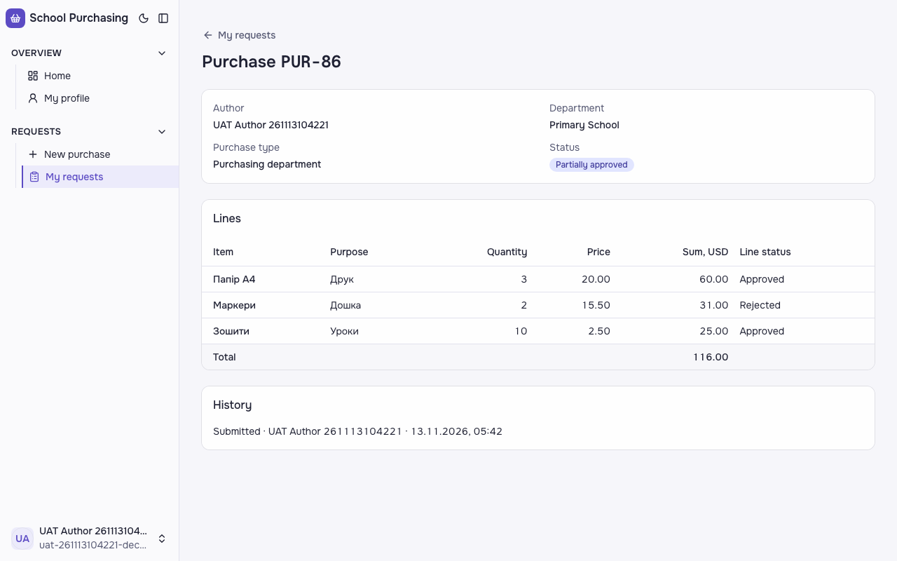

**Кроки:** ✔ Дано: заявка відділу «Початкова школа» з трьома рядками зі статусом «Очікує схвалення», автор — не Марія, Марія схвалює цей відділ → ✔ Коли: Марія відхиляє рядок 2 і схвалює заявку → ✔ Тоді: статус заявки «Частково схвалено», автор бачить рядок 2 зі статусом «Відхилено», а рядки 1 і 3 — зі статусом «Схвалено».

**Агент (claude-haiku-5-5, PASS):** На кадрі сторінка «Purchase PUR-86» зі статусом «Partially approved» і колонкою «Line status»: «Папір А4» — Approved, «Маркери» — Rejected, «Зошити» — Approved. Усі чотири видимі частини «Тоді» підтверджені дослівно; текст читабельний, кадр повний. Статус у кадрі англійською, що збігається з переліком видимих частин у ac.md, хоча сам критерій формулює його як «Частково схвалено».

**Цитати агента, звірені зі сторінкою (aria):**
- «Partially approved» — є на сторінці
- «Маркери» — є на сторінці
- «Rejected» — є на сторінці
- «Папір А4» — є на сторінці
- «Approved» — є на сторінці
- «Зошити» — є на сторінці
- «Approved» — є на сторінці

**Правило:** R6: перевірки, агент і цитати збігаються

**Відео:** `test-results/artifacts/purchase-history-схвалювач-28bc5-ted»-рядки-1-і-3-«Approved»-chromium/video.webm` · **траса:** `test-results/artifacts/purchase-history-схвалювач-28bc5-ted»-рядки-1-і-3-«Approved»-chromium/trace.zip` (не в git)

**Рішення PM:** ☐ приймаю · ☐ відхилення від вимог (issue «Відхилення від вимог: AC-DEC-01 — …») · @login: ____

## AC-DEC-04 — PASS

**Тест:** AC-DEC-04: Марія повертає заявку з причиною «Уточніть кількість» — «Returned for revision»

**Критерій** (requirements/63-skhvaliuvach-chastkovo-skhvaliuie.md):

> AC-DEC-04: Дано заявка відділу «Початкова школа» зі статусом «Очікує схвалення», автор — не Марія, Марія схвалює цей відділ. Коли Марія повертає заявку на доопрацювання з причиною «Уточніть кількість». Тоді статус заявки «Повернено на доопрацювання».

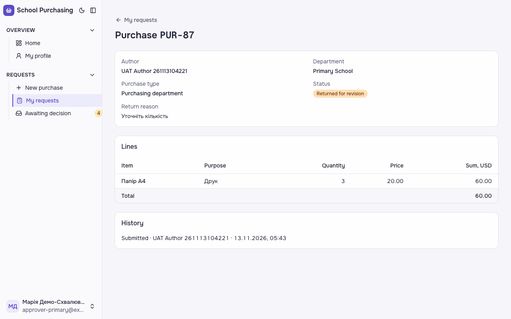

**Кроки:** ✔ Дано: заявка відділу «Початкова школа» зі статусом «Очікує схвалення», автор — не Марія, Марія схвалює цей відділ → ✔ Коли: Марія повертає заявку на доопрацювання з причиною «Уточніть кількість» → ✔ Тоді: статус заявки «Повернено на доопрацювання».

**Агент (claude-sonnet-5-5, PASS):** На сторінці Purchase PUR-87 поле Status має бейдж «Returned for revision», а поле Return reason показує «Уточніть кількість». Обидві видимі частини збігаються з критерієм. Статус у базі з кадрів не оцінювався.

Haiku сказав FAIL, тож розбір повторив Sonnet; рішення агента — за Sonnet.
Чому Haiku: На кадрі сторінка заявки PUR-87 (відділ Primary School) із статусом «Returned for revision» і причиною повернення «Уточніть кількість» — причина збігається дослівно. Статус не збігається з українським текстом критерію, тож я ставлю FAIL за правилом посимвольної звірки; якщо PM мав на увазі англійський текст із переліку, цю частину варто перевірити повторно, і тоді вердикт може стати PASS.; «статус заявки «Повернено на доопрацювання» (за критерієм) / «Returned for revision» (за переліком видимих частин)» — not-met («Returned for revision»)

**Цитати агента, звірені зі сторінкою (aria):**
- «Returned for revision» — є на сторінці
- «Уточніть кількість» — є на сторінці

**Правило:** R6: перевірки, агент і цитати збігаються

**Відео:** `test-results/artifacts/purchase-history-схвалювач-f1372-»-—-«Returned-for-revision»-chromium/video.webm` · **траса:** `test-results/artifacts/purchase-history-схвалювач-f1372-»-—-«Returned-for-revision»-chromium/trace.zip` (не в git)

**Рішення PM:** ☐ приймаю · ☐ відхилення від вимог (issue «Відхилення від вимог: AC-DEC-04 — …») · @login: ____

## AC-DEC-06 — PASS

**Тест:** AC-DEC-06: повернення без причини — «Provide a reason», статус лишається «Awaiting approval»

**Критерій** (requirements/63-skhvaliuvach-chastkovo-skhvaliuie.md):

> AC-DEC-06: Дано заявка відділу «Початкова школа» зі статусом «Очікує схвалення», Марія схвалює цей відділ. Коли Марія повертає заявку на доопрацювання без причини. Тоді вона бачить повідомлення «Вкажіть причину», а статус заявки лишається «Очікує схвалення».

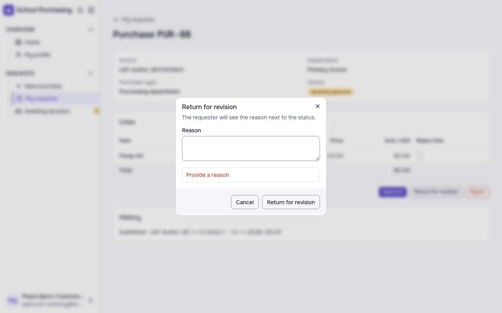
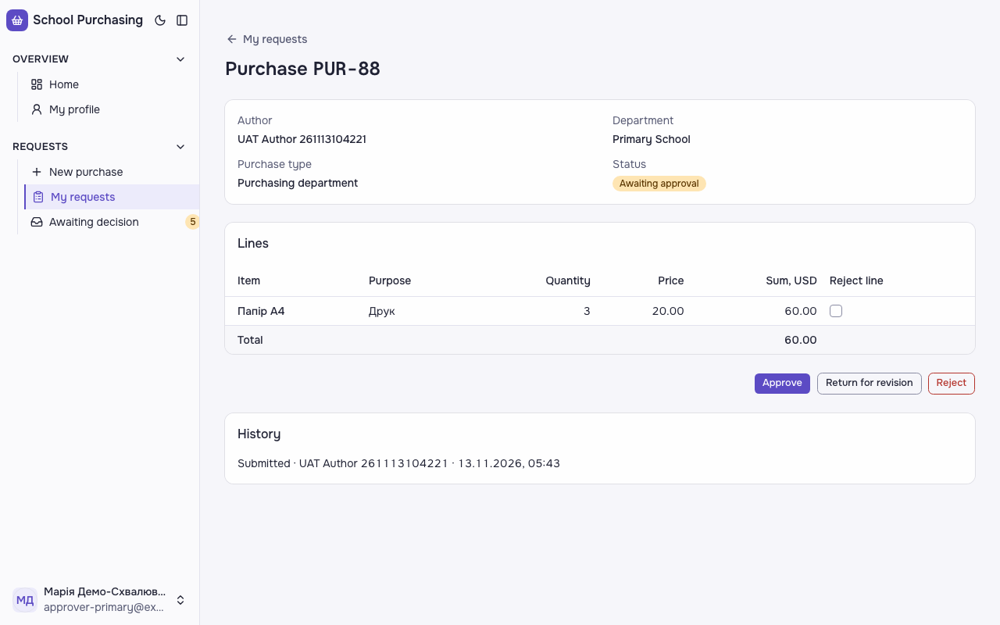

**Кроки:** ✔ Дано: заявка відділу «Початкова школа» зі статусом «Очікує схвалення», Марія схвалює цей відділ → ✔ Коли: Марія повертає заявку на доопрацювання без причини → ✔ Тоді: вона бачить повідомлення «Вкажіть причину» → ✔ Тоді: а статус заявки лишається «Очікує схвалення».

**Агент (claude-haiku-5-5, PASS):** На кадрі 1 видно відкритий діалог «Return for revision» з червоним повідомленням «Provide a reason» під порожнім полем Reason. На кадрі 2 діалог закрито, сторінка «Purchase PUR-88» показує статус «Awaiting approval» (жовта плашка). Ключові тексти перевірені за переліком у ac.md; у самому критерії (українською) написано «Вкажіть причину» і «Очікує схвалення», але видимі частини в ac.md задані англійськими рядками, тому оцінено за ними. Факт оновлення сторінки з кадру 2 не видно напряму, тож статус вважаю видимим у стані після закриття діалогу.

**Цитати агента, звірені зі сторінкою (aria):**
- «Provide a reason» — є на сторінці
- «Awaiting approval» — є на сторінці

**Правило:** R6: перевірки, агент і цитати збігаються

**Відео:** `test-results/artifacts/purchase-history-схвалювач-d7d6c-шається-«Awaiting-approval»-chromium/video.webm` · **траса:** `test-results/artifacts/purchase-history-схвалювач-d7d6c-шається-«Awaiting-approval»-chromium/trace.zip` (не в git)

**Рішення PM:** ☐ приймаю · ☐ відхилення від вимог (issue «Відхилення від вимог: AC-DEC-06 — …») · @login: ____

## AC-DEC-07 — PASS

**Тест:** AC-DEC-07: автор виправив рядок 1 поверненої заявки й подав знову — «Awaiting approval», відділ той самий

**Критерій** (requirements/63-skhvaliuvach-chastkovo-skhvaliuie.md):

> AC-DEC-07: Дано заявка зі статусом «Повернено на доопрацювання», автор виправив рядок 1. Коли автор подає заявку знову. Тоді статус заявки «Очікує схвалення», відділ той самий.

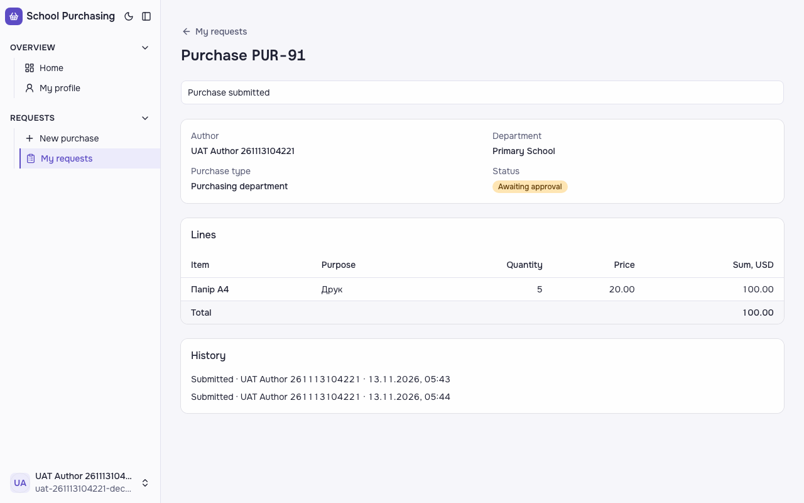

**Кроки:** ✔ Дано: заявка зі статусом «Повернено на доопрацювання», автор виправив рядок 1 → ✔ Коли: автор подає заявку знову → ✔ Тоді: статус заявки «Очікує схвалення», відділ той самий.

**Агент (claude-haiku-5-5, PASS):** На кадрі видно сторінку PUR-91 із відділом «Primary School», рядком «Папір А4» з кількістю 5 та статусом «Awaiting approval». Статус на екрані англійською, тоді як критерій очікує «Очікує схвалення», тому видима частина статусу не збігається посимвольно. Відділ і рядок збігаються з критерієм; «той самий відділ, що при першому поданні» з одного кадру не перевірити, але видимий відділ — Primary School.

**Агент бачить вади:**
- Розбіжність у назві статусу: критерій вимагає українську «Очікує схвалення», а на кадрі англійська «Awaiting approval». Це 1:1 за текстом критерію — not-met.

**Цитати агента, звірені зі сторінкою (aria):**
- «Primary School» — є на сторінці
- «Папір А4» — є на сторінці
- «5» — є на сторінці

**Правило:** R6: перевірки, агент і цитати збігаються

**Відео:** `test-results/artifacts/purchase-history-синтетичн-f18ee--approval»-відділ-той-самий-chromium/video.webm` · **траса:** `test-results/artifacts/purchase-history-синтетичн-f18ee--approval»-відділ-той-самий-chromium/trace.zip` (не в git)

**Рішення PM:** ☐ приймаю · ☐ відхилення від вимог (issue «Відхилення від вимог: AC-DEC-07 — …») · @login: ____

## AC-FRM-08 — PASS

**Тест:** AC-FRM-08: заявник того ж відділу відкриває чужу закупівлю за прямим посиланням — «Not enough permissions», даних не показано, статус не змінився

**Критерій** (requirements/47-pratsivnyk-podaie-zakupivliu-cherez-formu.md):

> AC-FRM-08: Дано працівник 1 подав закупівлю у відділ «Початкова школа», а працівник 2 — заявник того ж відділу, не автор і не схвалювач. Коли працівник 2 відкриває закупівлю працівника 1 за прямим посиланням. Тоді він бачить повідомлення «Недостатньо прав», даних закупівлі йому не показано, а закупівля працівника 1 лишається зі статусом «Очікує схвалення».

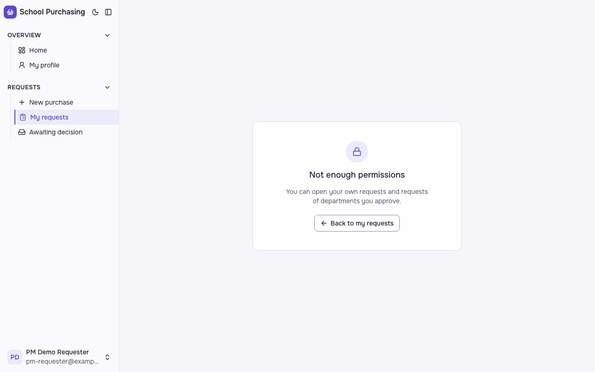

**Кроки:** ✔ Дано: працівник 1 подав закупівлю у відділ «Початкова школа», а працівник 2 — заявник того ж відділу, не автор і не схвалювач → ✔ Коли: працівник 2 відкриває закупівлю працівника 1 за прямим посиланням → ✔ Тоді: він бачить повідомлення «Недостатньо прав», даних закупівлі йому не показано, а закупівля працівника 1 лишається зі статусом «Очікує схвалення».

**Агент (claude-sonnet-5-5, PASS):** На кадрі в центрі єдина картка з написом «Not enough permissions», поясненням і кнопкою «Back to my requests». Рядків закупівлі, суми чи автора не видно. Частини з розділу «Не з кадрів» не оцінювалися.

Haiku сказав FAIL, тож розбір повторив Sonnet; рішення агента — за Sonnet.
Чому Haiku: На кадрі видно картку з замком і написом «Not enough permissions» та поясненням «You can open your own requests and requests of departments you approve.», без рядків закупівлі, суми чи автора. Частина про приховані дані виконана, але текст повідомлення не збігається з «Недостатньо прав», тому вердикт FAIL.; «повідомлення «Недостатньо прав»» — not-met («Not enough permissions»)

**Цитати агента, звірені зі сторінкою (aria):**
- «Not enough permissions» — є на сторінці
- «You can open your own requests and requests of departments you approve.» — є на сторінці

**Правило:** R6: перевірки, агент і цитати збігаються

**Відео:** `test-results/artifacts/purchase-працівник-2-pm-re-75e54-показано-статус-не-змінився-chromium/video.webm` · **траса:** `test-results/artifacts/purchase-працівник-2-pm-re-75e54-показано-статус-не-змінився-chromium/trace.zip` (не в git)

**Рішення PM:** ☐ приймаю · ☐ відхилення від вимог (issue «Відхилення від вимог: AC-FRM-08 — …») · @login: ____

## AC-FRM-14 — PASS

**Тест:** AC-FRM-14: працівник без жодної заявки відкриває «My requests» — «You have not submitted any requests yet», списку немає

**Критерій** (requirements/47-pratsivnyk-podaie-zakupivliu-cherez-formu.md):

> AC-FRM-14: Дано працівник 3 без жодної заявки. Коли він відкриває сторінку «Мої заявки». Тоді він бачить повідомлення «Ви ще не подали жодної заявки», а списку заявок немає.

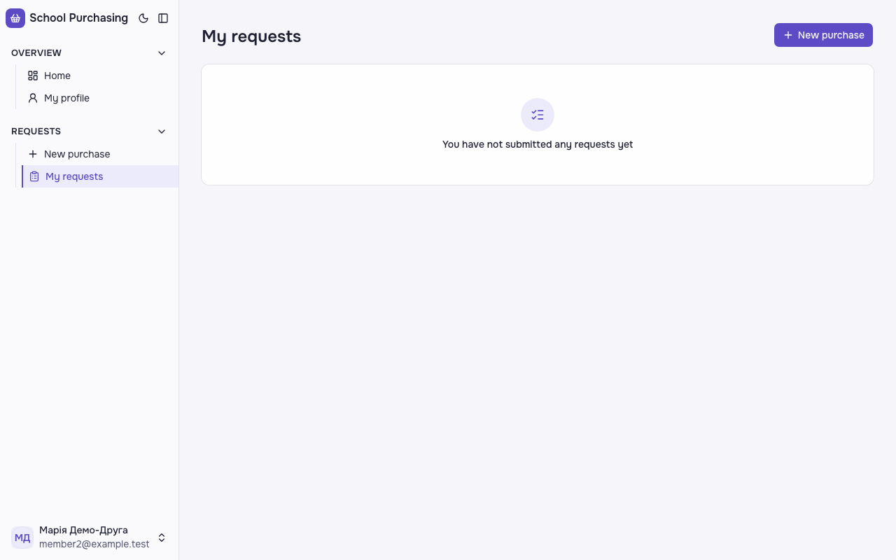

**Кроки:** ✔ Дано: працівник 3 без жодної заявки → ✔ Коли: він відкриває сторінку «Мої заявки» → ✔ Тоді: він бачить повідомлення «Ви ще не подали жодної заявки», а списку заявок немає.

**Агент (claude-sonnet-5-5, PASS):** На кадрі видно заголовок «My requests» і в порожньому блоці повідомлення «You have not submitted any requests yet»; видимого списку чи таблиці немає. Користувач на кадрі — member2@example.test; відповідність «працівнику 3» з кадру не перевірялась.

Haiku сказав NEEDS-HUMAN, тож розбір повторив Sonnet; рішення агента — за Sonnet.
Чому Haiku: На кадрі видно сторінку з заголовком «My requests», кнопкою «New purchase», порожнім станом з написом «You have not submitted any requests yet» і пунктом меню «My requests», виділеним у бічній панелі. Частини з переліку ac.md збігаються з кадром, але дослівний критерій PM українською, тому вердикт NEEDS-HUMAN, а не PASS; відсутність рядків заявок з кадру не видно.; «списку заявок немає: жодного рядка заявки (data-testid="request-row") і таблиці «my-requests»» — cannot-tell

**Цитати агента, звірені зі сторінкою (aria):**
- «My requests» — є на сторінці
- «You have not submitted any requests yet» — є на сторінці

**Правило:** R6: перевірки, агент і цитати збігаються

**Відео:** `test-results/artifacts/purchase-працівник-3-membe-9b1c6--requests-yet»-списку-немає-chromium/video.webm` · **траса:** `test-results/artifacts/purchase-працівник-3-membe-9b1c6--requests-yet»-списку-немає-chromium/trace.zip` (не в git)

**Рішення PM:** ☐ приймаю · ☐ відхилення від вимог (issue «Відхилення від вимог: AC-FRM-14 — …») · @login: ____

## AC-FRM-15 — PASS

**Тест:** AC-FRM-15: рядок лише з назвою «Папір А4» — «Fill in all line fields», закупівлю не подано

**Критерій** (requirements/47-pratsivnyk-podaie-zakupivliu-cherez-formu.md):

> AC-FRM-15: Дано працівник 1 обрав відділ «Початкова школа», тип «Відділ закупівель» і додав рядок лише з назвою «Папір А4», без мети, кількості й ціни. Коли він намагається подати закупівлю. Тоді він бачить повідомлення «Заповніть усі поля рядка», а закупівлю не подано.

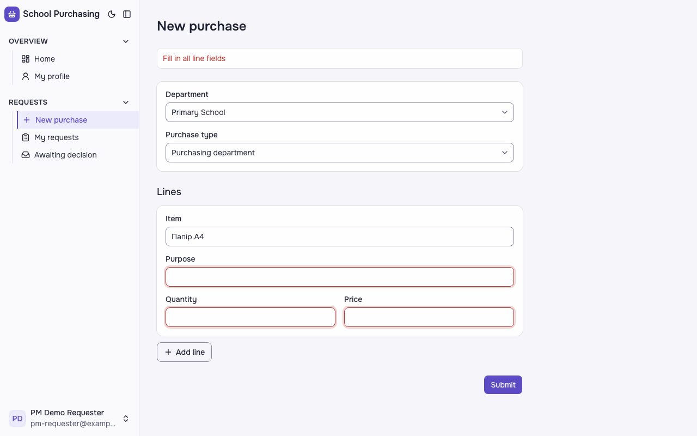

**Кроки:** ✔ Дано: працівник 1 обрав відділ «Початкова школа», тип «Відділ закупівель» і додав рядок лише з назвою «Папір А4», без мети, кількості й ціни → ✔ Коли: він намагається подати закупівлю → ✔ Тоді: він бачить повідомлення «Заповніть усі поля рядка», а закупівлю не подано.

**Агент (claude-sonnet-5-5, PASS):** На кадрі сторінка «New purchase» з червоним повідомленням «Fill in all line fields» над формою. У полі Item лишається «Папір А4», а поля Purpose, Quantity і Price порожні та підсвічені червоним. Частину про те, що закупівлю не подано, за кадрами не оцінював.

Haiku сказав FAIL, тож розбір повторив Sonnet; рішення агента — за Sonnet.
Чому Haiku: На кадрі /requests/new видно червоне повідомлення «Fill in all line fields» над формою, а поля Purpose, Quantity і Price підсвічені червоним. Форма лишилася відкритою: заголовок «New purchase», у полі Item є «Папір А4», відділ і тип закупівлі заповнені. Вердикт FAIL, бо текст повідомлення не збігається з критерієм «Заповніть усі поля рядка»; якщо PM вважає правильним англійський текст, потрібне уточнення і повторна перевірка.; «повідомлення «Fill in all line fields» над формою (критерій: «Заповніть усі поля рядка»)» — not-met

**Цитати агента, звірені зі сторінкою (aria):**
- «Fill in all line fields» — є на сторінці
- «New purchase» — є на сторінці
- «Папір А4» — є на сторінці

**Правило:** R6: перевірки, агент і цитати збігаються

**Відео:** `test-results/artifacts/purchase-працівник-1-pm-re-000b0-fields»-закупівлю-не-подано-chromium/video.webm` · **траса:** `test-results/artifacts/purchase-працівник-1-pm-re-000b0-fields»-закупівлю-не-подано-chromium/trace.zip` (не в git)

**Рішення PM:** ☐ приймаю · ☐ відхилення від вимог (issue «Відхилення від вимог: AC-FRM-15 — …») · @login: ____

## AC-HIST-01 — PASS

**Тест:** AC-HIST-01: працівник 1 подає дві закупівлі — у «My requests» номери PUR-n і PUR-(n+1)

**Критерій** (requirements/64-zaiavka-maie-nomer-sumy-riadkiv.md):

> AC-HIST-01: Дано в системі ще немає жодної закупівлі. Коли працівник 1 подає першу закупівлю, а потім другу. Тоді в списку «Мої заявки» вони мають номери «PUR-1» і «PUR-2».

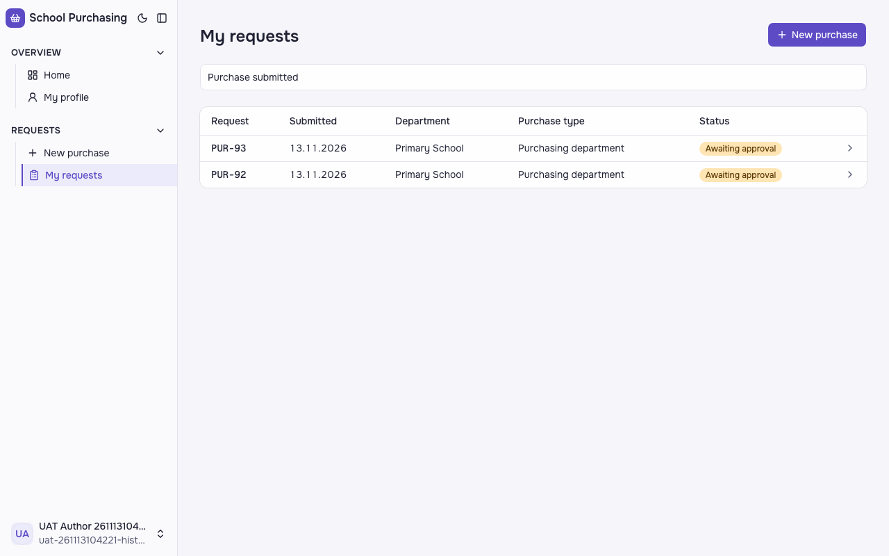

**Кроки:** ✔ Дано: в системі ще немає жодної закупівлі (на проді — у працівника 1 ще немає жодної; номери глобальні, відповідь PM на ValiaBihun/2026-quitcode-dream-team#73) → ✔ Коли: працівник 1 подає першу закупівлю, а потім другу → ✔ Тоді: в списку «Мої заявки» вони мають номери «PUR-1» і «PUR-2» (на проді — «PUR-n» і «PUR-(n+1)»: друга на одиницю більша).

**Агент (claude-haiku-5-5, PASS):** На кадрі сторінки «My requests» видно дві заявки: вгорі PUR-93, нижче PUR-92, обидві з датою 13.11.2026 і статусом «Awaiting approval». Це відповідає видимій частині «Тоді»: друга заявка (PUR-93) вища за першу (PUR-92), і номери послідовні. Конкретні номери PUR-1 і PUR-2 на кадрі не видно — за критерієм їх доводить автотест на порожній базі, я цього не оцінював.

**Цитати агента, звірені зі сторінкою (aria):**
- «PUR-93» — є на сторінці
- «PUR-92» — є на сторінці

**Правило:** R6: перевірки, агент і цитати збігаються

**Відео:** `test-results/artifacts/purchase-history-синтетичн-495c1-s»-номери-PUR-n-і-PUR--n-1--chromium/video.webm` · **траса:** `test-results/artifacts/purchase-history-синтетичн-495c1-s»-номери-PUR-n-і-PUR--n-1--chromium/trace.zip` (не в git)

**Рішення PM:** ☐ приймаю · ☐ відхилення від вимог (issue «Відхилення від вимог: AC-HIST-01 — …») · @login: ____

## AC-HIST-02 — PASS

**Тест:** AC-HIST-02: рядки 3 × 20.00 і 2 × 15.50 — суми рядків 60.00 і 31.00, сума заявки 91.00

**Критерій** (requirements/64-zaiavka-maie-nomer-sumy-riadkiv.md):

> AC-HIST-02: Дано закупівля з двома рядками: кількість 3 за ціною 20.00 і кількість 2 за ціною 15.50. Коли автор відкриває заявку. Тоді суми рядків 60.00 і 31.00, а сума заявки 91.00.

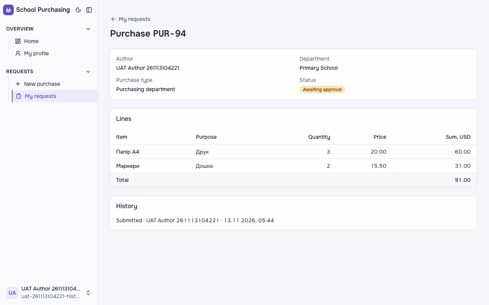

**Кроки:** ✔ Дано: закупівля з двома рядками: кількість 3 за ціною 20.00 і кількість 2 за ціною 15.50 → ✔ Коли: автор відкриває заявку → ✔ Тоді: суми рядків 60.00 і 31.00, а сума заявки 91.00.

**Агент (claude-haiku-5-5, PASS):** На кадрі сторінки «Purchase PUR-94» у таблиці Lines колонка «Sum, USD» показує 60.00 для «Папір А4» (3 × 20.00) і 31.00 для «Маркери» (2 × 15.50). Рядок Total показує 91.00. Кадр повний і читабельний, усі три видимі частини підтверджено.

**Цитати агента, звірені зі сторінкою (aria):**
- «Sum, USD» — є на сторінці
- «Папір А4» — є на сторінці
- «60.00» — є на сторінці
- «Sum, USD» — є на сторінці
- «Маркери» — є на сторінці
- «31.00» — є на сторінці
- «Total» — є на сторінці
- «91.00» — є на сторінці

**Правило:** R6: перевірки, агент і цитати збігаються

**Відео:** `test-results/artifacts/purchase-history-синтетичн-cc169-0-і-31-00-сума-заявки-91-00-chromium/video.webm` · **траса:** `test-results/artifacts/purchase-history-синтетичн-cc169-0-і-31-00-сума-заявки-91-00-chromium/trace.zip` (не в git)

**Рішення PM:** ☐ приймаю · ☐ відхилення від вимог (issue «Відхилення від вимог: AC-HIST-02 — …») · @login: ____

## AC-HIST-06 — PASS

**Тест:** AC-HIST-06: в історії запис «Submitted» з іменем автора і датою та часом America/New_York

**Критерій** (requirements/64-zaiavka-maie-nomer-sumy-riadkiv.md):

> AC-HIST-06: Дано працівник 1 подав закупівлю у відділ «Початкова школа». Коли він відкриває історію цієї заявки. Тоді в історії є запис «Подано» з його іменем і датою та часом за часом `America/New_York`.

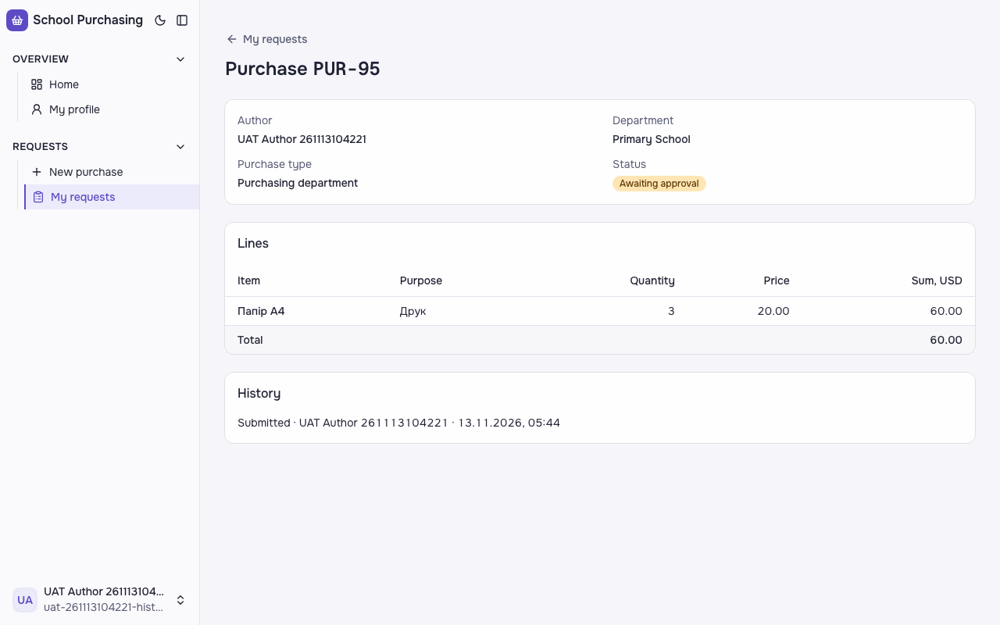

**Кроки:** ✔ Дано: працівник 1 подав закупівлю у відділ «Початкова школа» → ✔ Коли: він відкриває історію цієї заявки → ✔ Тоді: в історії є запис «Подано» з його іменем і датою та часом за часом `America/New_York`.

**Агент (claude-sonnet-5-5, PASS):** У блоці History видно один запис «Submitted · UAT Author 261113104221 · 13.11.2026, 05:44», що збігається з очікуваним шаблоном. Часовий пояс за кадром не перевіряв. Відділ Primary School, статус Awaiting approval.

Haiku сказав FAIL, тож розбір повторив Sonnet; рішення агента — за Sonnet.
Чому Haiku: На кадрі видно сторінку заявки PUR-95 з блоком «History», де один запис: «Submitted · UAT Author 261113104221 · 13.11.2026, 05:44». Ім'я автора та формат дати й часу відповідають критерію, але саме слово у записі — «Submitted», а не «Подано». Часовий пояс America/New_York з кадрів не перевіряється.; «у «History» запис «Подано» з його іменем і датою та часом (видима частина: «Submitted · UAT Author 261113104221 · 13.11.2026, ГГ:ХХ»)» — not-met («Submitted · UAT Author 261113104221 · 13.11.2026, 05:44»); «дата й година за America/New_York» — cannot-tell

**Цитати агента, звірені зі сторінкою (aria):**
- «Submitted · UAT Author 261113104221 · 13.11.2026, 05:44» — є на сторінці

**Правило:** R6: перевірки, агент і цитати збігаються

**Відео:** `test-results/artifacts/purchase-history-синтетичн-70721-ю-та-часом-America-New-York-chromium/video.webm` · **траса:** `test-results/artifacts/purchase-history-синтетичн-70721-ю-та-часом-America-New-York-chromium/trace.zip` (не в git)

**Рішення PM:** ☐ приймаю · ☐ відхилення від вимог (issue «Відхилення від вимог: AC-HIST-06 — …») · @login: ____

## AC-HIST-10 — PASS

**Тест:** AC-HIST-10: Петро («Office») відкриває заявку «Primary School» за прямим посиланням — «Not enough permissions», історії немає, статус не змінився

**Критерій** (requirements/64-zaiavka-maie-nomer-sumy-riadkiv.md):

> AC-HIST-10: Дано Петро схвалює лише відділ «Офіс», заявка відділу «Початкова школа» з історією рішень. Коли Петро відкриває історію цієї заявки за прямим посиланням. Тоді він бачить повідомлення «Недостатньо прав», історії не показано, а статус заявки не змінився.

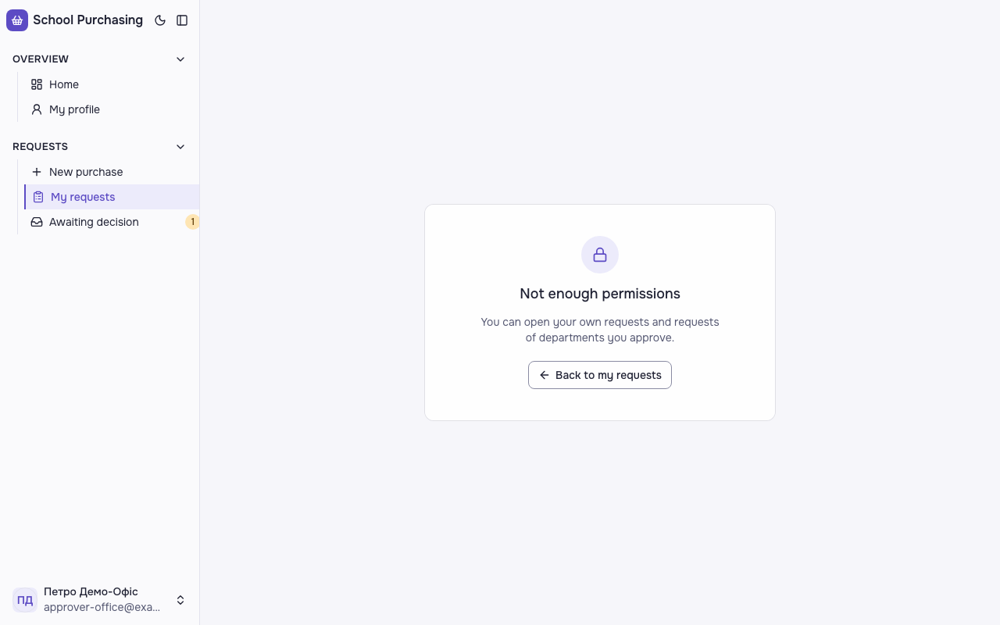

**Кроки:** ✔ Дано: Петро схвалює лише відділ «Офіс», заявка відділу «Початкова школа» з історією рішень → ✔ Коли: Петро відкриває історію цієї заявки за прямим посиланням → ✔ Тоді: він бачить повідомлення «Недостатньо прав», історії не показано, а статус заявки не змінився.

**Агент (claude-sonnet-5-5, PASS):** На кадрі в центрі єдина картка з написом «Not enough permissions», поясненням і кнопкою «Back to my requests». Розділу «History» та даних заявки немає. Статус у базі за кадром не оцінювався.

Haiku сказав FAIL, тож розбір повторив Sonnet; рішення агента — за Sonnet.
Чому Haiku: На кадрі видно картку відмови з заголовком «Not enough permissions» і текстом «You can open your own requests and requests of departments you approve.» з кнопкою «Back to my requests». Розділу «History» і даних заявки немає, тож відсутність історії підтверджена. Текст повідомлення не збігається з критерієм, тому частина про «Недостатньо прав» не виконана.; «повідомлення «Недостатньо прав»» — not-met

**Цитати агента, звірені зі сторінкою (aria):**
- «Not enough permissions» — є на сторінці
- «Not enough permissions» — є на сторінці
- «You can open your own requests and requests of departments you approve.» — є на сторінці
- «Back to my requests» — є на сторінці

**Правило:** R6: перевірки, агент і цитати збігаються

**Відео:** `test-results/artifacts/purchase-history-схвалювач-ad113-ії-немає-статус-не-змінився-chromium/video.webm` · **траса:** `test-results/artifacts/purchase-history-схвалювач-ad113-ії-немає-статус-не-змінився-chromium/trace.zip` (не в git)

**Рішення PM:** ☐ приймаю · ☐ відхилення від вимог (issue «Відхилення від вимог: AC-HIST-10 — …») · @login: ____

## AC-LANG-09 — PASS

**Тест:** AC-LANG-09: статуси «Partially approved» і «Returned for revision» підписано текстом у списку й на сторінці заявки

**Критерій** (requirements/49-interfeis-zastosunku-angliiskoiu.md):

> AC-LANG-09: Дано заявка зі статусом «Частково схвалено» чи «Повернено на доопрацювання». Коли її показано у списку, на сторінці заявки або в історії. Тоді статус підписано текстом «Partially approved» чи «Returned for revision» відповідно, а не лише кольором.

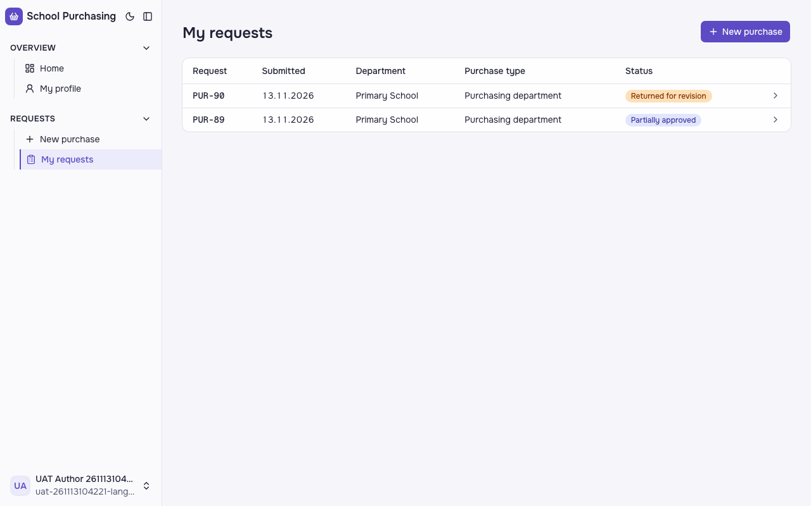
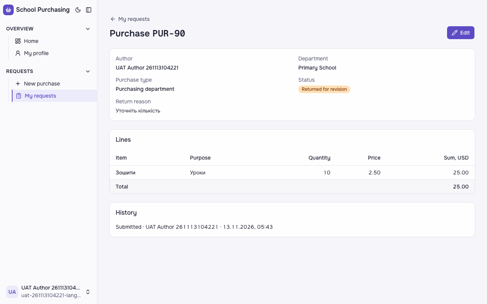
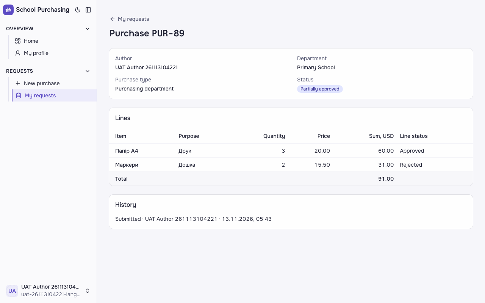

**Кроки:** ✔ Дано: заявки зі статусом «Частково схвалено» і «Повернено на доопрацювання» → ✔ Коли: їх показано у списку «My requests» автора → ✔ Тоді: статус підписано текстом «Partially approved» чи «Returned for revision» відповідно, а не лише кольором. → ✔ Коли: заявку «Повернено на доопрацювання» показано на сторінці заявки → ✔ Тоді: статус підписано текстом «Returned for revision», а не лише кольором. → ✔ Коли: заявку «Частково схвалено» показано на сторінці заявки → ✔ Тоді: статус підписано текстом «Partially approved», а не лише кольором.

**Агент (claude-haiku-5-5, PASS):** На кадрі списку «My requests» видно обидві заявки з текстовими бейджами: «Returned for revision» (PUR-90) і «Partially approved» (PUR-89). На сторінках заявок статус також підписаний текстом: «Returned for revision» для PUR-90 і «Partially approved» для PUR-89. Частину «в історії» кадри не показують, тому її не оцінено.

**Цитати агента, звірені зі сторінкою (aria):**
- «Returned for revision» — є на сторінці
- «Partially approved» — є на сторінці
- «Returned for revision» — є на сторінці
- «Partially approved» — є на сторінці

**Правило:** R6: перевірки, агент і цитати збігаються

**Відео:** `test-results/artifacts/purchase-history-схвалювач-38e00-списку-й-на-сторінці-заявки-chromium/video.webm` · **траса:** `test-results/artifacts/purchase-history-схвалювач-38e00-списку-й-на-сторінці-заявки-chromium/trace.zip` (не в git)

**Рішення PM:** ☐ приймаю · ☐ відхилення від вимог (issue «Відхилення від вимог: AC-LANG-09 — …») · @login: ____

## Як читати підсумок

- **PASS** — автоматичні перевірки пройшли, агент-рецензент погодився з кадром, а кожну його цитату знайдено на сторінці.
- **FAIL** — впала автоматична перевірка. Агент цього не перекриває: невидимі вади (буфер обміну, база) він на кадрі не побачить.
- **NEEDS-HUMAN** — перевірки зелені, але агент не погодився або його цитати немає на сторінці. Часто це слабкий тест або розбіжність між текстом AC і тестом — питання до PM, а не обов'язково вада продукту.

Правила: R1: перевірка впала — FAIL завжди, агент не перекриває; R2: немає вердикту агента або кадру; R3: перевірки пройшли, агент не погоджується — вирішує людина; R4: цитати агента немає на сторінці (aria) — не підтверджено; R5: помилка сторінки або 5xx під час сценарію; R6: перевірки, агент і цитати збігаються.
