# Звіт UAT — 13.11.2026

- **Застосунок:** https://therapy-scheduling-ten.vercel.app (/api/health: коміт `71dd645`)
- **Код тестів:** `task/pm-remarks` @ `abedb7f`
- **Прогін:** 13.11.2026, 09:53 (Київ), Playwright 194.2 с; AC: 12 — PASS 11, FAIL 0, NEEDS-HUMAN 1
- **Рецензент:** `claude-haiku-5-5`; суперечки → `claude-sonnet-5-5`. Разом за розбір: $0.2884 (ціни API; за підпискою — у межах ліміту плану)
- **Прибирання:** синтетичних uat-*@example.test видалено 9, лишилось 0, їхніх рядків, що лишились: 0
- **Відео й траси:** не в git — `test-results/` локально або артефакт CI; трасу відкриває `npx playwright show-trace <trace.zip>`

| AC | Перевірки | Агент | Підсумок | Чому | Playwright | Розбір |
|---|---|---|---|---|---|---|
| AC-DEC-01 | пройшли | Haiku: NEEDS-HUMAN, Sonnet: PASS | **PASS** | R6: перевірки, агент і цитати збігаються | 17.7 с | $0.0333, 19.5 с |
| AC-DEC-04 | пройшли | Haiku: FAIL, Sonnet: PASS | **PASS** | R6: перевірки, агент і цитати збігаються | 12.8 с | $0.0392, 15.5 с |
| AC-DEC-06 | пройшли | Haiku: FAIL, Sonnet: NEEDS-HUMAN | **NEEDS-HUMAN** | R3: перевірки пройшли, агент не погоджується — вирішує людина | 11.2 с | $0.0456, 23.1 с |
| AC-DEC-07 | пройшли | Haiku: NEEDS-HUMAN, Sonnet: PASS | **PASS** | R6: перевірки, агент і цитати збігаються | 19.2 с | $0.0340, 20.8 с |
| AC-FRM-08 | пройшли | Haiku: FAIL, Sonnet: PASS | **PASS** | R6: перевірки, агент і цитати збігаються | 6.7 с | $0.0321, 14.5 с |
| AC-FRM-14 | пройшли | Haiku: NEEDS-HUMAN, Sonnet: PASS | **PASS** | R6: перевірки, агент і цитати збігаються | 3.1 с | $0.0338, 20.2 с |
| AC-FRM-15 | пройшли | Haiku: FAIL, Sonnet: PASS | **PASS** | R6: перевірки, агент і цитати збігаються | 10.4 с | $0.0311, 13.8 с |
| AC-HIST-01 | пройшли | Haiku: PASS | **PASS** | R6: перевірки, агент і цитати збігаються | 23.7 с | $0.0020, 7.4 с |
| AC-HIST-02 | пройшли | Haiku: PASS | **PASS** | R6: перевірки, агент і цитати збігаються | 6.7 с | $0.0021, 8.3 с |
| AC-HIST-06 | пройшли | Haiku: FAIL, Sonnet: PASS | **PASS** | R6: перевірки, агент і цитати збігаються | 7.5 с | $0.0305, 14.9 с |
| AC-HIST-10 | пройшли | Haiku: PASS | **PASS** | R6: перевірки, агент і цитати збігаються | 10.4 с | $0.0020, 7.8 с |
| AC-LANG-09 | пройшли | Haiku: PASS | **PASS** | R6: перевірки, агент і цитати збігаються | 25.3 с | $0.0029, 9.0 с |

## AC-DEC-01 — PASS

**Тест:** AC-DEC-01: Марія відхиляє рядок 2 і схвалює — «Partially approved», рядок 2 «Rejected», рядки 1 і 3 «Approved»

**Критерій** (requirements/63-skhvaliuvach-chastkovo-skhvaliuie.md):

> AC-DEC-01: Дано заявка відділу «Початкова школа» з трьома рядками зі статусом «Очікує схвалення», автор — не Марія, Марія схвалює цей відділ. Коли Марія відхиляє рядок 2 і схвалює заявку. Тоді статус заявки «Частково схвалено», автор бачить рядок 2 зі статусом «Відхилено», а рядки 1 і 3 — зі статусом «Схвалено».

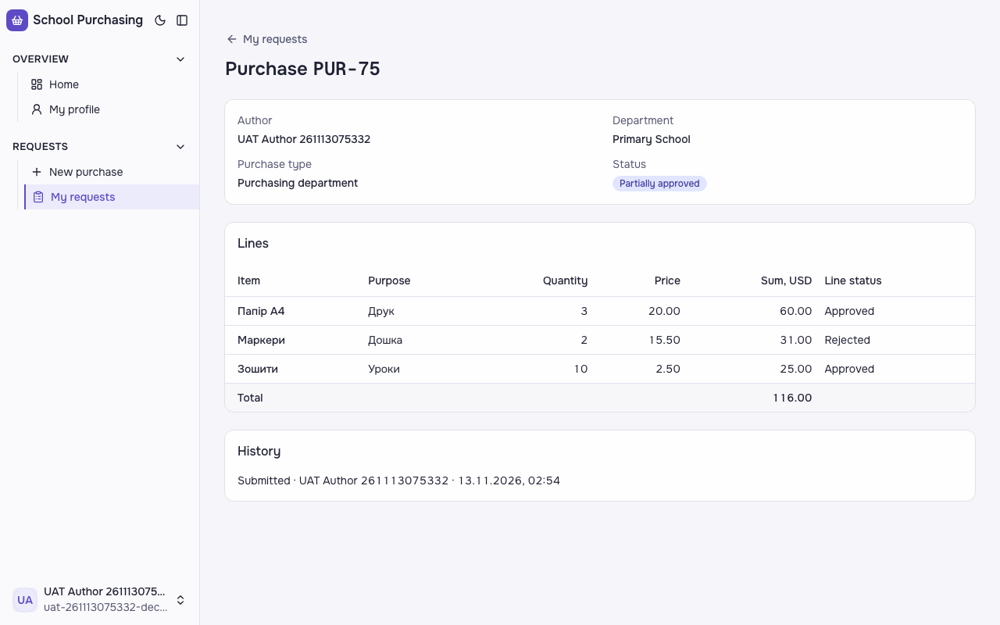

**Кроки:** ✔ Дано: заявка відділу «Початкова школа» з трьома рядками зі статусом «Очікує схвалення», автор — не Марія, Марія схвалює цей відділ → ✔ Коли: Марія відхиляє рядок 2 і схвалює заявку → ✔ Тоді: статус заявки «Частково схвалено», автор бачить рядок 2 зі статусом «Відхилено», а рядки 1 і 3 — зі статусом «Схвалено».

**Агент (claude-sonnet-5-5, PASS):** На кадрі сторінка Purchase PUR-75 зі статусом «Partially approved». У таблиці рядків Папір А4 — Approved, Маркери — Rejected, Зошити — Approved.

Haiku сказав NEEDS-HUMAN, тож розбір повторив Sonnet; рішення агента — за Sonnet.
Чому Haiku: На кадрі сторінка заявки PUR-75 відділу Primary School: статус «Partially approved», рядок «Маркери» має «Rejected», «Папір А4» і «Зошити» мають «Approved». Логіка збігається з критерієм, але статуси на екрані англійською, а критерій написаний українською, тому посимвольна звірка дає розбіжність. Тому вердикт NEEDS-HUMAN, а не PASS.

**Цитати агента, звірені зі сторінкою (aria):**
- «Partially approved» — є на сторінці
- «Папір А4» — є на сторінці
- «Approved» — є на сторінці
- «Маркери» — є на сторінці
- «Rejected» — є на сторінці
- «Зошити» — є на сторінці
- «Approved» — є на сторінці

**Правило:** R6: перевірки, агент і цитати збігаються

**Відео:** `test-results/artifacts/purchase-history-схвалювач-28bc5-ted»-рядки-1-і-3-«Approved»-chromium/video.webm` · **траса:** `test-results/artifacts/purchase-history-схвалювач-28bc5-ted»-рядки-1-і-3-«Approved»-chromium/trace.zip` (не в git)

**Рішення PM:** ☐ приймаю · ☐ відхилення від вимог (issue «Відхилення від вимог: AC-DEC-01 — …») · @login: ____

## AC-DEC-04 — PASS

**Тест:** AC-DEC-04: Марія повертає заявку з причиною «Уточніть кількість» — «Returned for revision»

**Критерій** (requirements/63-skhvaliuvach-chastkovo-skhvaliuie.md):

> AC-DEC-04: Дано заявка відділу «Початкова школа» зі статусом «Очікує схвалення», автор — не Марія, Марія схвалює цей відділ. Коли Марія повертає заявку на доопрацювання з причиною «Уточніть кількість». Тоді статус заявки «Повернено на доопрацювання».

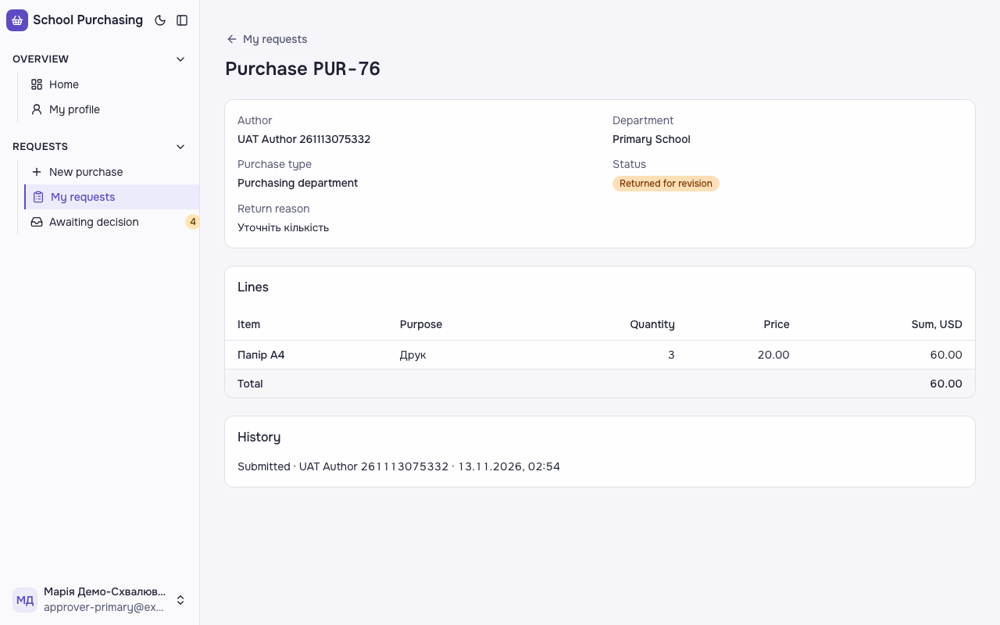

**Кроки:** ✔ Дано: заявка відділу «Початкова школа» зі статусом «Очікує схвалення», автор — не Марія, Марія схвалює цей відділ → ✔ Коли: Марія повертає заявку на доопрацювання з причиною «Уточніть кількість» → ✔ Тоді: статус заявки «Повернено на доопрацювання».

**Агент (claude-sonnet-5-5, PASS):** На сторінці Purchase PUR-76 бачимо поле Status зі значком «Returned for revision» і поле Return reason з текстом «Уточніть кількість». Відділ — Primary School, кадр читабельний. Статус у базі за кадрами не оцінювався.

Haiku сказав FAIL, тож розбір повторив Sonnet; рішення агента — за Sonnet.
Чому Haiku: На кадрі видно бейдж статусу «Returned for revision» і причину повернення «Уточніть кількість». Причина збігається з критерієм, а статус — ні: критерій очікує український текст «Повернено на доопрацювання», а інтерфейс показує англійський варіант. Статус у базі не оцінювався.; «статус заявки «Повернено на доопрацювання»» — not-met («Returned for revision»); «статус у базі — returned» — cannot-tell

**Цитати агента, звірені зі сторінкою (aria):**
- «Status» — є на сторінці
- «Returned for revision» — є на сторінці
- «Return reason» — є на сторінці
- «Уточніть кількість» — є на сторінці

**Правило:** R6: перевірки, агент і цитати збігаються

**Відео:** `test-results/artifacts/purchase-history-схвалювач-f1372-»-—-«Returned-for-revision»-chromium/video.webm` · **траса:** `test-results/artifacts/purchase-history-схвалювач-f1372-»-—-«Returned-for-revision»-chromium/trace.zip` (не в git)

**Рішення PM:** ☐ приймаю · ☐ відхилення від вимог (issue «Відхилення від вимог: AC-DEC-04 — …») · @login: ____

## AC-DEC-06 — NEEDS-HUMAN

**Тест:** AC-DEC-06: повернення без причини — «Provide a reason», статус лишається «Awaiting approval»

**Критерій** (requirements/63-skhvaliuvach-chastkovo-skhvaliuie.md):

> AC-DEC-06: Дано заявка відділу «Початкова школа» зі статусом «Очікує схвалення», Марія схвалює цей відділ. Коли Марія повертає заявку на доопрацювання без причини. Тоді вона бачить повідомлення «Вкажіть причину», а статус заявки лишається «Очікує схвалення».

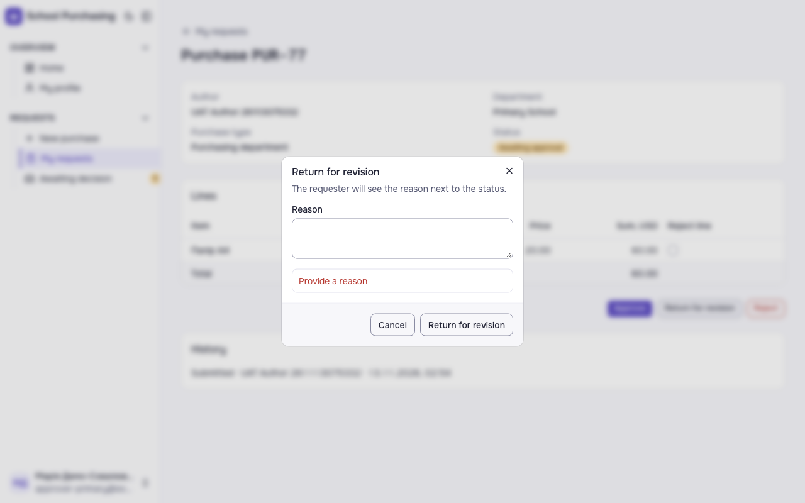
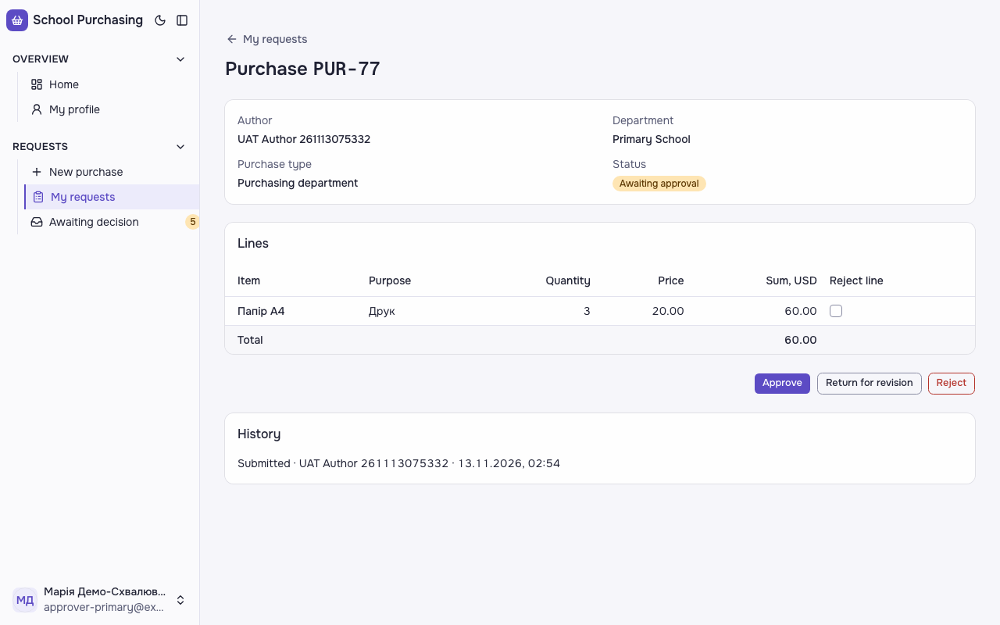

**Кроки:** ✔ Дано: заявка відділу «Початкова школа» зі статусом «Очікує схвалення», Марія схвалює цей відділ → ✔ Коли: Марія повертає заявку на доопрацювання без причини → ✔ Тоді: вона бачить повідомлення «Вкажіть причину» → ✔ Тоді: а статус заявки лишається «Очікує схвалення».

**Агент (claude-sonnet-5-5, NEEDS-HUMAN):** На кадрі 1 відкритий діалог «Return for revision» з порожнім полем Reason і червоним повідомленням «Provide a reason». На кадрі 2 сторінка PUR-77 показує статус «Awaiting approval». Збіг лише за змістом з англійським перекладом; чи прийнятна відмінність мови від тексту PM, має вирішити людина.

Haiku сказав FAIL, тож розбір повторив Sonnet; рішення агента — за Sonnet.
Чому Haiku: На frame-then-1.png у діалозі «Return for revision» під полем «Reason» видно червоний напис «Provide a reason», тобто повідомлення про відсутню причину з'являється, але мовою, відмінною від критерію. На frame-then-2.png після закриття діалогу статус заявки показано як «Awaiting approval» з помаранчевим бейджем, тобто статус не змінився, але напис відрізняється від «Очікує схвалення». За правилом посимвольної звірки обидві частини не пройшли.; «повідомлення «Вкажіть причину» у відкритому діалозі «Return for revision»» — not-met («Provide a reason»); «після закриття діалогу й оновлення сторінки статус заявки — «Очікує схвалення»» — not-met («Awaiting approval»)

**Агент бачить вади:**
- Текст критерію PM — «Вкажіть причину» та «Очікує схвалення» українською, а інтерфейс на кадрах англійською («Provide a reason», «Awaiting approval»). Дослівного збігу з критерієм немає.

**Цитати агента, звірені зі сторінкою (aria):**
- «Return for revision» — є на сторінці
- «Provide a reason» — є на сторінці
- «Status» — є на сторінці
- «Awaiting approval» — є на сторінці

**Правило:** R3: перевірки пройшли, агент не погоджується — вирішує людина

**Відео:** `test-results/artifacts/purchase-history-схвалювач-d7d6c-шається-«Awaiting-approval»-chromium/video.webm` · **траса:** `test-results/artifacts/purchase-history-схвалювач-d7d6c-шається-«Awaiting-approval»-chromium/trace.zip` (не в git)

**Рішення PM:** ☐ приймаю · ☐ відхилення від вимог (issue «Відхилення від вимог: AC-DEC-06 — …») · @login: ____

## AC-DEC-07 — PASS

**Тест:** AC-DEC-07: автор виправив рядок 1 поверненої заявки й подав знову — «Awaiting approval», відділ той самий

**Критерій** (requirements/63-skhvaliuvach-chastkovo-skhvaliuie.md):

> AC-DEC-07: Дано заявка зі статусом «Повернено на доопрацювання», автор виправив рядок 1. Коли автор подає заявку знову. Тоді статус заявки «Очікує схвалення», відділ той самий.

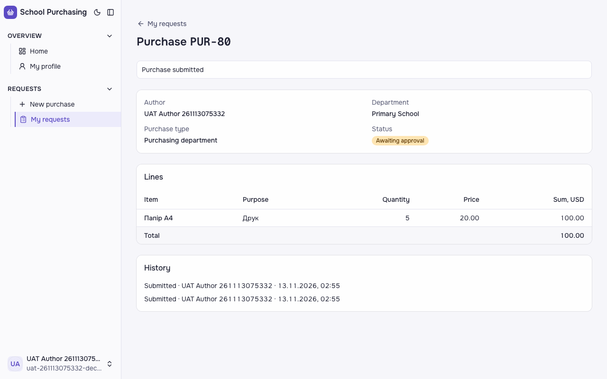

**Кроки:** ✔ Дано: заявка зі статусом «Повернено на доопрацювання», автор виправив рядок 1 → ✔ Коли: автор подає заявку знову → ✔ Тоді: статус заявки «Очікує схвалення», відділ той самий.

**Агент (claude-sonnet-5-5, PASS):** На сторінці Purchase PUR-80 видно статус «Awaiting approval», відділ «Primary School» і рядок «Папір А4» з кількістю 5. Кадр не показує попередні значення, тож «той самий відділ» і «виправлено» підтверджені лише поточним станом. В історії є два записи «Submitted» і жодного запису про повернення.

Haiku сказав NEEDS-HUMAN, тож розбір повторив Sonnet; рішення агента — за Sonnet.
Чому Haiku: На кадрі видно сторінку PUR-80 із статусом «Awaiting approval», відділом «Primary School» і рядком «Папір А4» з кількістю 5. Частини «Тоді» збігаються з переліком у ac.md, але статус на кадрі англійською, а критерій формулює його як «Очікує схвалення», тому через посимвольну перевірку та правило сумніву вердикт — NEEDS-HUMAN, а не PASS.

**Цитати агента, звірені зі сторінкою (aria):**
- «Status» — є на сторінці
- «Awaiting approval» — є на сторінці
- «Department» — є на сторінці
- «Primary School» — є на сторінці
- «Папір А4» — є на сторінці
- «Друк» — є на сторінці
- «5» — є на сторінці
- «20.00» — є на сторінці
- «100.00» — є на сторінці

**Правило:** R6: перевірки, агент і цитати збігаються

**Відео:** `test-results/artifacts/purchase-history-синтетичн-f18ee--approval»-відділ-той-самий-chromium/video.webm` · **траса:** `test-results/artifacts/purchase-history-синтетичн-f18ee--approval»-відділ-той-самий-chromium/trace.zip` (не в git)

**Рішення PM:** ☐ приймаю · ☐ відхилення від вимог (issue «Відхилення від вимог: AC-DEC-07 — …») · @login: ____

## AC-FRM-08 — PASS

**Тест:** AC-FRM-08: заявник того ж відділу відкриває чужу закупівлю за прямим посиланням — «Not enough permissions», даних не показано, статус не змінився

**Критерій** (requirements/47-pratsivnyk-podaie-zakupivliu-cherez-formu.md):

> AC-FRM-08: Дано працівник 1 подав закупівлю у відділ «Початкова школа», а працівник 2 — заявник того ж відділу, не автор і не схвалювач. Коли працівник 2 відкриває закупівлю працівника 1 за прямим посиланням. Тоді він бачить повідомлення «Недостатньо прав», даних закупівлі йому не показано, а закупівля працівника 1 лишається зі статусом «Очікує схвалення».

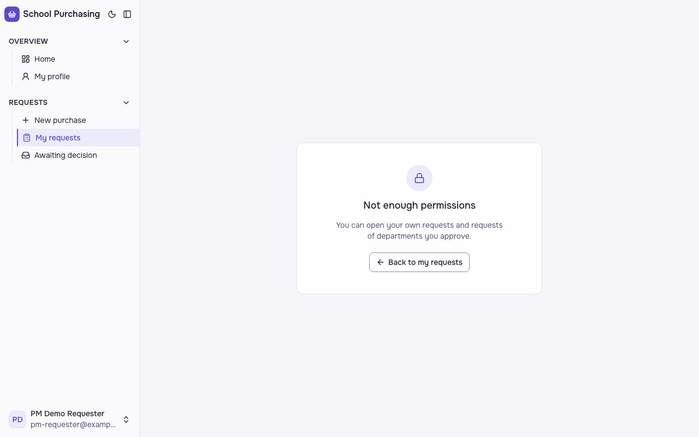

**Кроки:** ✔ Дано: працівник 1 подав закупівлю у відділ «Початкова школа», а працівник 2 — заявник того ж відділу, не автор і не схвалювач → ✔ Коли: працівник 2 відкриває закупівлю працівника 1 за прямим посиланням → ✔ Тоді: він бачить повідомлення «Недостатньо прав», даних закупівлі йому не показано, а закупівля працівника 1 лишається зі статусом «Очікує схвалення».

**Агент (claude-sonnet-5-5, PASS):** На кадрі по центру картка із заголовком «Not enough permissions», поясненням і кнопкою «Back to my requests». Рядків закупівлі, суми чи автора на сторінці не видно.

Haiku сказав FAIL, тож розбір повторив Sonnet; рішення агента — за Sonnet.
Чому Haiku: На кадрі видно картку відмови без даних закупівлі: немає рядків, суми чи автора, лише іконка замка, заголовок і кнопка «Back to my requests». Заголовок відмови — англійською «Not enough permissions», а не «Недостатньо прав», тому перша частина «Тоді» не підтверджена. Статус «Очікує схвалення» з кадру не видно, його перевіряють автоматичні перевірки.; «повідомлення «Недостатньо прав»» — not-met

**Цитати агента, звірені зі сторінкою (aria):**
- «Not enough permissions» — є на сторінці
- «You can open your own requests and requests of departments you approve.» — є на сторінці

**Правило:** R6: перевірки, агент і цитати збігаються

**Відео:** `test-results/artifacts/purchase-працівник-2-pm-re-75e54-показано-статус-не-змінився-chromium/video.webm` · **траса:** `test-results/artifacts/purchase-працівник-2-pm-re-75e54-показано-статус-не-змінився-chromium/trace.zip` (не в git)

**Рішення PM:** ☐ приймаю · ☐ відхилення від вимог (issue «Відхилення від вимог: AC-FRM-08 — …») · @login: ____

## AC-FRM-14 — PASS

**Тест:** AC-FRM-14: працівник без жодної поданої заявки відкриває «My requests» — «You have not submitted any requests yet», списку немає

**Критерій** (requirements/47-pratsivnyk-podaie-zakupivliu-cherez-formu.md):

> AC-FRM-14: Дано працівник 3 без жодної заявки. Коли він відкриває сторінку «Мої заявки». Тоді він бачить повідомлення «Ви ще не подали жодної заявки», а списку заявок немає.

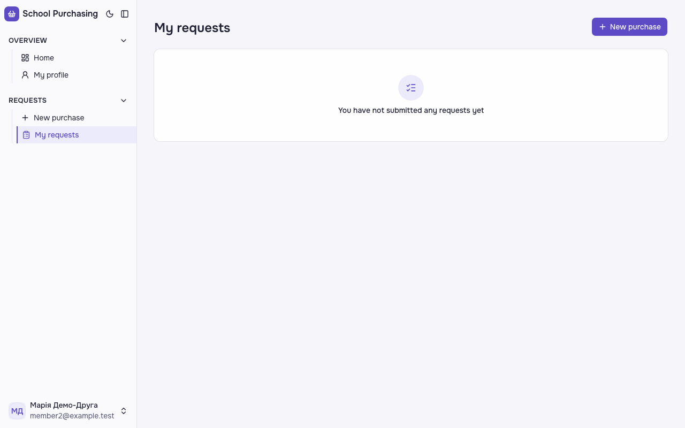

**Кроки:** ✔ Дано: працівник 3 без жодної поданої заявки → ✔ Коли: він відкриває сторінку «Мої заявки» → ✔ Тоді: він бачить повідомлення «Ви ще не подали жодної заявки», а списку заявок немає.

**Агент (claude-sonnet-5-5, PASS):** На кадрі сторінка /requests із заголовком «My requests» і порожнім станом з написом «You have not submitted any requests yet». Таблиці чи рядків заявок на кадрі не видно, але цю частину я не оцінював.

Haiku сказав NEEDS-HUMAN, тож розбір повторив Sonnet; рішення агента — за Sonnet.
Чому Haiku: На кадрі сторінки /requests видно порожній стан: заголовок «My requests» і повідомлення «You have not submitted any requests yet» без жодного рядка заявки. Відсутність списку та таблиці не оцінюю, бо це «Не з кадрів». Вирок NEEDS-HUMAN, а не PASS, бо текст на екрані не збігається з українським текстом критерію, і рецензент не може сам вирішити, який текст правильний.; «повідомлення «Ви ще не подали жодної заявки» (текст самого критерію)» — not-met

**Агент бачить вади:**
- На кадрі в боковій панелі видно користувача «Марія Демо-Друга», member2@example.test; з кадру не можна підтвердити, що це «працівник 3» з критерію (це частина «Дано», не «Тоді»).

**Цитати агента, звірені зі сторінкою (aria):**
- «My requests» — є на сторінці
- «You have not submitted any requests yet» — є на сторінці

**Правило:** R6: перевірки, агент і цитати збігаються

**Відео:** `test-results/artifacts/purchase-працівник-3-membe-b1424--requests-yet»-списку-немає-chromium/video.webm` · **траса:** `test-results/artifacts/purchase-працівник-3-membe-b1424--requests-yet»-списку-немає-chromium/trace.zip` (не в git)

**Рішення PM:** ☐ приймаю · ☐ відхилення від вимог (issue «Відхилення від вимог: AC-FRM-14 — …») · @login: ____

## AC-FRM-15 — PASS

**Тест:** AC-FRM-15: рядок лише з назвою «Папір А4» — «Fill in all line fields», закупівлю не подано

**Критерій** (requirements/47-pratsivnyk-podaie-zakupivliu-cherez-formu.md):

> AC-FRM-15: Дано працівник 1 обрав відділ «Початкова школа», тип «Відділ закупівель» і додав рядок лише з назвою «Папір А4», без мети, кількості й ціни. Коли він намагається подати закупівлю. Тоді він бачить повідомлення «Заповніть усі поля рядка», а закупівлю не подано.

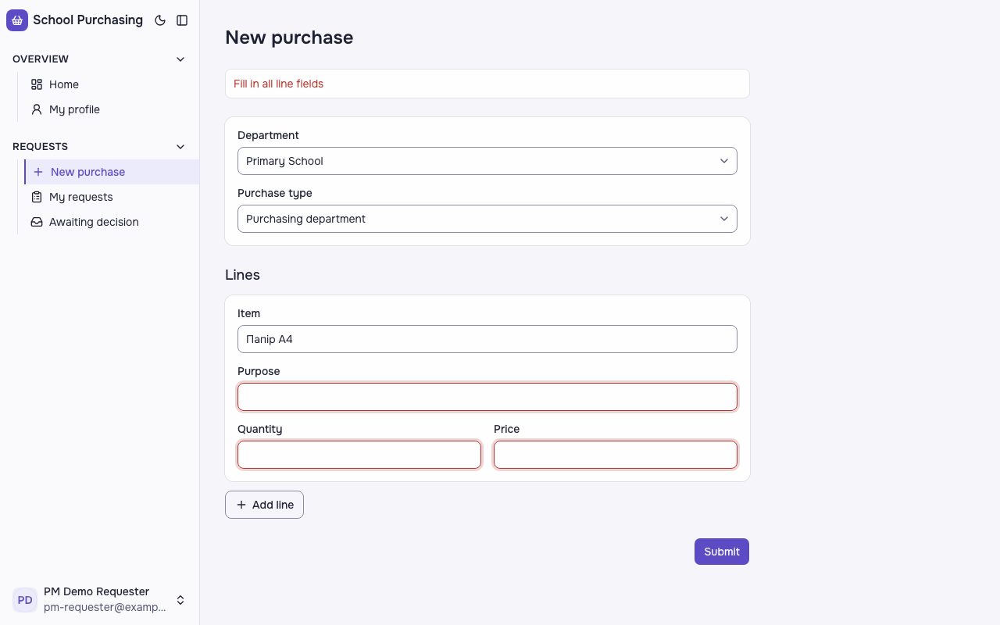

**Кроки:** ✔ Дано: працівник 1 обрав відділ «Початкова школа», тип «Відділ закупівель» і додав рядок лише з назвою «Папір А4», без мети, кількості й ціни → ✔ Коли: він намагається подати закупівлю → ✔ Тоді: він бачить повідомлення «Заповніть усі поля рядка», а закупівлю не подано.

**Агент (claude-sonnet-5-5, PASS):** На кадрі над формою видно червоне повідомлення «Fill in all line fields». Форма «New purchase» лишається відкритою, у полі Item стоїть «Папір A4», а поля Purpose, Quantity і Price порожні та підсвічені червоним.

Haiku сказав FAIL, тож розбір повторив Sonnet; рішення агента — за Sonnet.
Чому Haiku: На кадрі над формою видно червоний напис «Fill in all line fields», а поля Purpose, Quantity і Price підсвічені червоним. Форма лишилася відкритою з рядком «Папір А4», тож друга частина «Тоді» виконана, але текст повідомлення не збігається з критерієм посимвольно.; «повідомлення «Заповніть усі поля рядка» над формою» — not-met

**Цитати агента, звірені зі сторінкою (aria):**
- «Fill in all line fields» — є на сторінці
- «New purchase» — є на сторінці
- «Item» — є на сторінці
- «Папір A4» — є на сторінці

**Правило:** R6: перевірки, агент і цитати збігаються

**Відео:** `test-results/artifacts/purchase-працівник-1-pm-re-000b0-fields»-закупівлю-не-подано-chromium/video.webm` · **траса:** `test-results/artifacts/purchase-працівник-1-pm-re-000b0-fields»-закупівлю-не-подано-chromium/trace.zip` (не в git)

**Рішення PM:** ☐ приймаю · ☐ відхилення від вимог (issue «Відхилення від вимог: AC-FRM-15 — …») · @login: ____

## AC-HIST-01 — PASS

**Тест:** AC-HIST-01: працівник 1 подає дві закупівлі — у «My requests» номери PUR-n і PUR-(n+1)

**Критерій** (requirements/64-zaiavka-maie-nomer-sumy-riadkiv.md):

> AC-HIST-01: Дано в системі ще немає жодної закупівлі. Коли працівник 1 подає першу закупівлю, а потім другу. Тоді в списку «Мої заявки» вони мають номери «PUR-1» і «PUR-2».

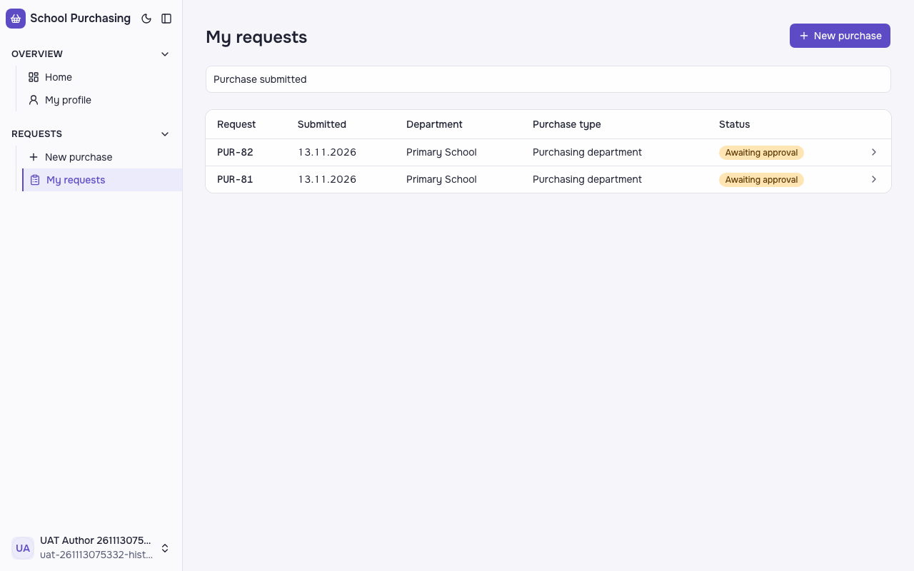

**Кроки:** ✔ Дано: в системі ще немає жодної закупівлі (на проді — у працівника 1 ще немає жодної; номери глобальні, відповідь PM на ValiaBihun/2026-quitcode-dream-team#73) → ✔ Коли: працівник 1 подає першу закупівлю, а потім другу → ✔ Тоді: в списку «Мої заявки» вони мають номери «PUR-1» і «PUR-2» (на проді — «PUR-n» і «PUR-(n+1)»: друга на одиницю більша).

**Агент (claude-haiku-5-5, PASS):** На кадрі сторінка «My requests» зі списком з двох заявок: вгорі PUR-82, під нею PUR-81, обидві «Awaiting approval», дата 13.11.2026. Це відповідає шаблону з ac.md: друга заявка (PUR-82) вища за першу (PUR-81). Буквальних номерів PUR-1 і PUR-2 на кадрі немає; за ac.md вони не оцінюються з кадрів, а доводяться автотестом, тож це не вада.

**Цитати агента, звірені зі сторінкою (aria):**
- «PUR-82» — є на сторінці
- «PUR-81» — є на сторінці

**Правило:** R6: перевірки, агент і цитати збігаються

**Відео:** `test-results/artifacts/purchase-history-синтетичн-495c1-s»-номери-PUR-n-і-PUR--n-1--chromium/video.webm` · **траса:** `test-results/artifacts/purchase-history-синтетичн-495c1-s»-номери-PUR-n-і-PUR--n-1--chromium/trace.zip` (не в git)

**Рішення PM:** ☐ приймаю · ☐ відхилення від вимог (issue «Відхилення від вимог: AC-HIST-01 — …») · @login: ____

## AC-HIST-02 — PASS

**Тест:** AC-HIST-02: рядки 3 × 20.00 і 2 × 15.50 — суми рядків 60.00 і 31.00, сума заявки 91.00

**Критерій** (requirements/64-zaiavka-maie-nomer-sumy-riadkiv.md):

> AC-HIST-02: Дано закупівля з двома рядками: кількість 3 за ціною 20.00 і кількість 2 за ціною 15.50. Коли автор відкриває заявку. Тоді суми рядків 60.00 і 31.00, а сума заявки 91.00.

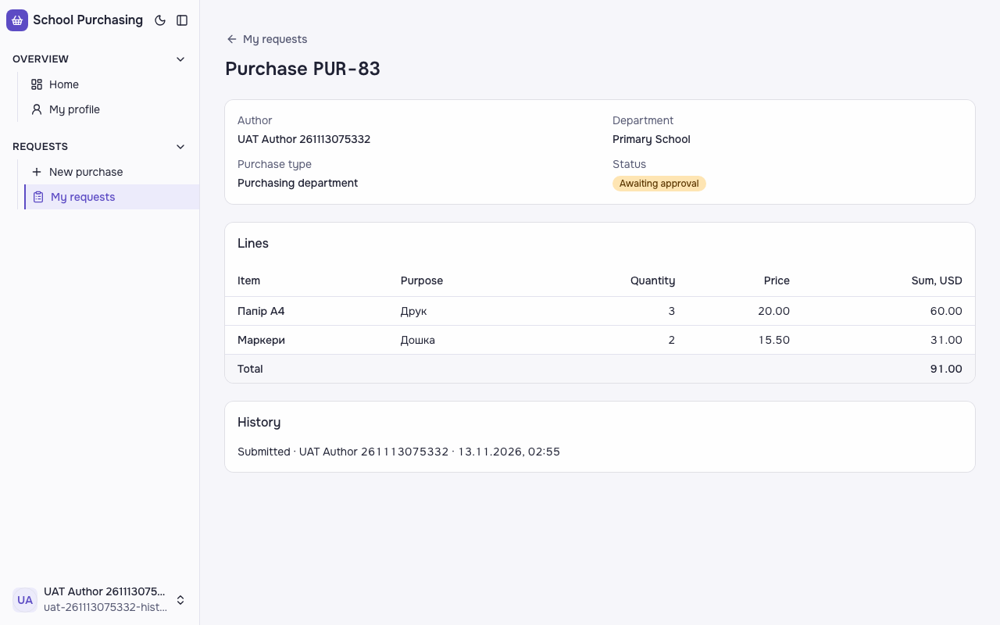

**Кроки:** ✔ Дано: закупівля з двома рядками: кількість 3 за ціною 20.00 і кількість 2 за ціною 15.50 → ✔ Коли: автор відкриває заявку → ✔ Тоді: суми рядків 60.00 і 31.00, а сума заявки 91.00.

**Агент (claude-haiku-5-5, PASS):** На кадрі сторінка «Purchase PUR-83» з таблицею Lines: рядок «Папір А4» (кількість 3, ціна 20.00) має Sum, USD 60.00; рядок «Маркери» (кількість 2, ціна 15.50) має 31.00. Рядок Total показує 91.00. Обидві видимі частини «Тоді» відповідають критерію; кадр повний, не обрізаний і читабельний.

**Цитати агента, звірені зі сторінкою (aria):**
- «Папір А4» — є на сторінці
- «60.00» — є на сторінці
- «Маркери» — є на сторінці
- «31.00» — є на сторінці
- «Total» — є на сторінці
- «91.00» — є на сторінці

**Правило:** R6: перевірки, агент і цитати збігаються

**Відео:** `test-results/artifacts/purchase-history-синтетичн-cc169-0-і-31-00-сума-заявки-91-00-chromium/video.webm` · **траса:** `test-results/artifacts/purchase-history-синтетичн-cc169-0-і-31-00-сума-заявки-91-00-chromium/trace.zip` (не в git)

**Рішення PM:** ☐ приймаю · ☐ відхилення від вимог (issue «Відхилення від вимог: AC-HIST-02 — …») · @login: ____

## AC-HIST-06 — PASS

**Тест:** AC-HIST-06: в історії запис «Submitted» з іменем автора і датою та часом America/New_York

**Критерій** (requirements/64-zaiavka-maie-nomer-sumy-riadkiv.md):

> AC-HIST-06: Дано працівник 1 подав закупівлю у відділ «Початкова школа». Коли він відкриває історію цієї заявки. Тоді в історії є запис «Подано» з його іменем і датою та часом за часом `America/New_York`.

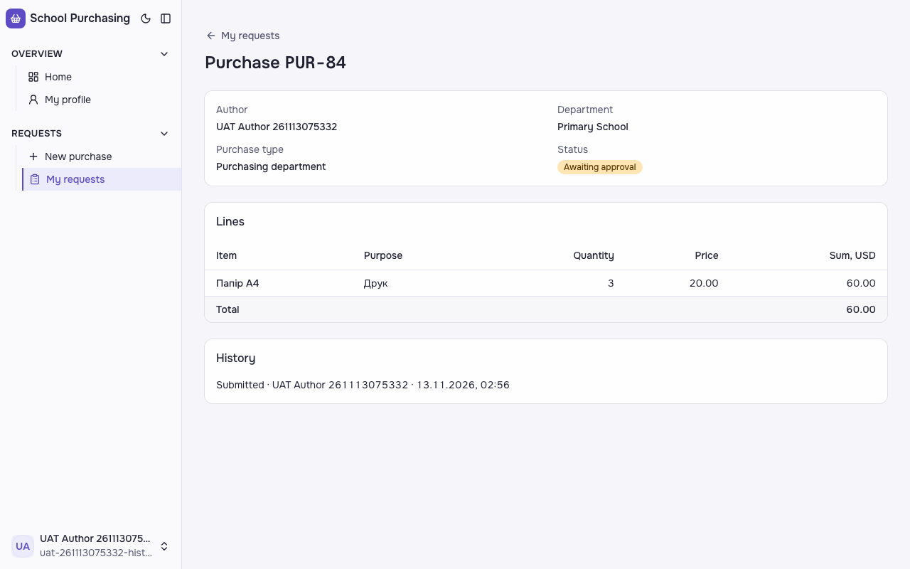

**Кроки:** ✔ Дано: працівник 1 подав закупівлю у відділ «Початкова школа» → ✔ Коли: він відкриває історію цієї заявки → ✔ Тоді: в історії є запис «Подано» з його іменем і датою та часом за часом `America/New_York`.

**Агент (claude-sonnet-5-5, PASS):** У блоці History видно один запис «Submitted · UAT Author 261113075332 · 13.11.2026, 02:56», що збігається з очікуваним шаблоном. Часовий пояс за кадром не перевіряв.

Haiku сказав FAIL, тож розбір повторив Sonnet; рішення агента — за Sonnet.
Чому Haiku: На кадрі в розділі «History» видно запис «Submitted · UAT Author 261113075332 · 13.11.2026, 02:56». Ім'я та дата з часом є, але подія записана англійською «Submitted», а не «Подано», тож вимога посимвольно не виконана. Часовий пояс America/New_York з кадру не видно, це не оцінювалося.; «у «History» запис «Submitted · UAT Author 261113075332 · 13.11.2026, ГГ:ХХ» (слово «Подано» з іменем, датою та часом)» — not-met («Submitted · UAT Author 261113075332 · 13.11.2026, 02:56»); «дата й година за часом America/New_York» — cannot-tell

**Цитати агента, звірені зі сторінкою (aria):**
- «Submitted · UAT Author 261113075332 · 13.11.2026, 02:56» — є на сторінці

**Правило:** R6: перевірки, агент і цитати збігаються

**Відео:** `test-results/artifacts/purchase-history-синтетичн-70721-ю-та-часом-America-New-York-chromium/video.webm` · **траса:** `test-results/artifacts/purchase-history-синтетичн-70721-ю-та-часом-America-New-York-chromium/trace.zip` (не в git)

**Рішення PM:** ☐ приймаю · ☐ відхилення від вимог (issue «Відхилення від вимог: AC-HIST-06 — …») · @login: ____

## AC-HIST-10 — PASS

**Тест:** AC-HIST-10: Петро («Office») відкриває заявку «Primary School» за прямим посиланням — «Not enough permissions», історії немає, статус не змінився

**Критерій** (requirements/64-zaiavka-maie-nomer-sumy-riadkiv.md):

> AC-HIST-10: Дано Петро схвалює лише відділ «Офіс», заявка відділу «Початкова школа» з історією рішень. Коли Петро відкриває історію цієї заявки за прямим посиланням. Тоді він бачить повідомлення «Недостатньо прав», історії не показано, а статус заявки не змінився.

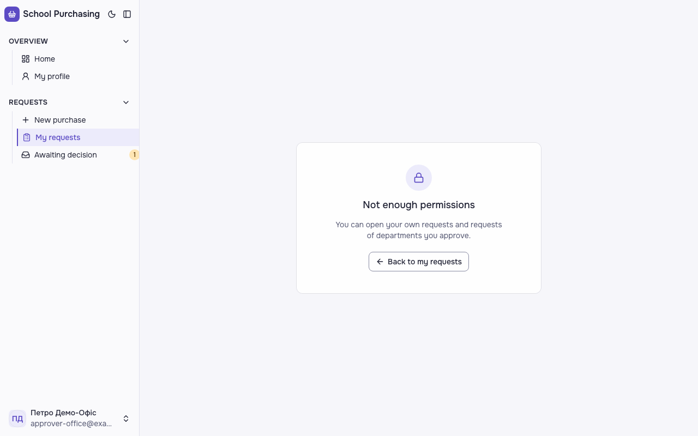

**Кроки:** ✔ Дано: Петро схвалює лише відділ «Офіс», заявка відділу «Початкова школа» з історією рішень → ✔ Коли: Петро відкриває історію цієї заявки за прямим посиланням → ✔ Тоді: він бачить повідомлення «Недостатньо прав», історії не показано, а статус заявки не змінився.

**Агент (claude-haiku-5-5, PASS):** На кадрі видно лише центральну картку з написом «Not enough permissions» і текстом «You can open your own requests and requests of departments you approve.», без розділу History чи даних заявки. Зауваження для PM: у тексті критерію сказано «Недостатньо прав», а в переліку видимих частин і на кадрі — англійське «Not enough permissions»; оцінено за переліком з ac.md.

**Цитати агента, звірені зі сторінкою (aria):**
- «Not enough permissions» — є на сторінці
- «Not enough permissions» — є на сторінці
- «You can open your own requests and requests of departments you approve.» — є на сторінці
- «Back to my requests» — є на сторінці

**Правило:** R6: перевірки, агент і цитати збігаються

**Відео:** `test-results/artifacts/purchase-history-схвалювач-ad113-ії-немає-статус-не-змінився-chromium/video.webm` · **траса:** `test-results/artifacts/purchase-history-схвалювач-ad113-ії-немає-статус-не-змінився-chromium/trace.zip` (не в git)

**Рішення PM:** ☐ приймаю · ☐ відхилення від вимог (issue «Відхилення від вимог: AC-HIST-10 — …») · @login: ____

## AC-LANG-09 — PASS

**Тест:** AC-LANG-09: статуси «Partially approved» і «Returned for revision» підписано текстом у списку й на сторінці заявки

**Критерій** (requirements/49-interfeis-zastosunku-angliiskoiu.md):

> AC-LANG-09: Дано заявка зі статусом «Частково схвалено» чи «Повернено на доопрацювання». Коли її показано у списку, на сторінці заявки або в історії. Тоді статус підписано текстом «Partially approved» чи «Returned for revision» відповідно, а не лише кольором.

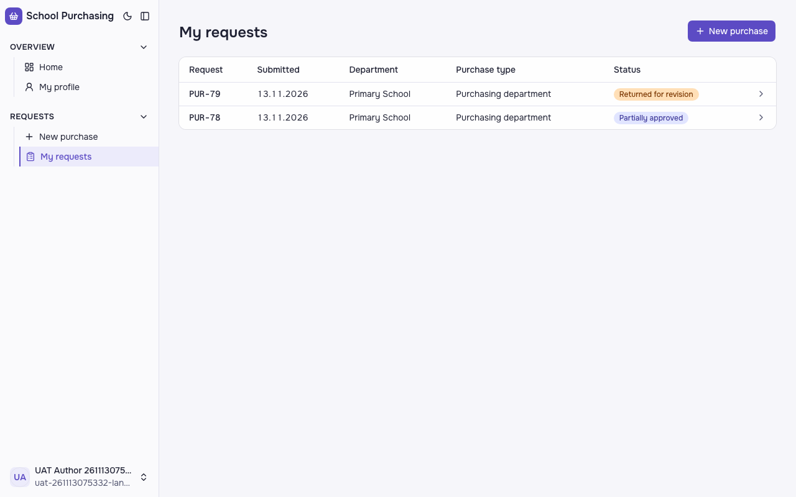
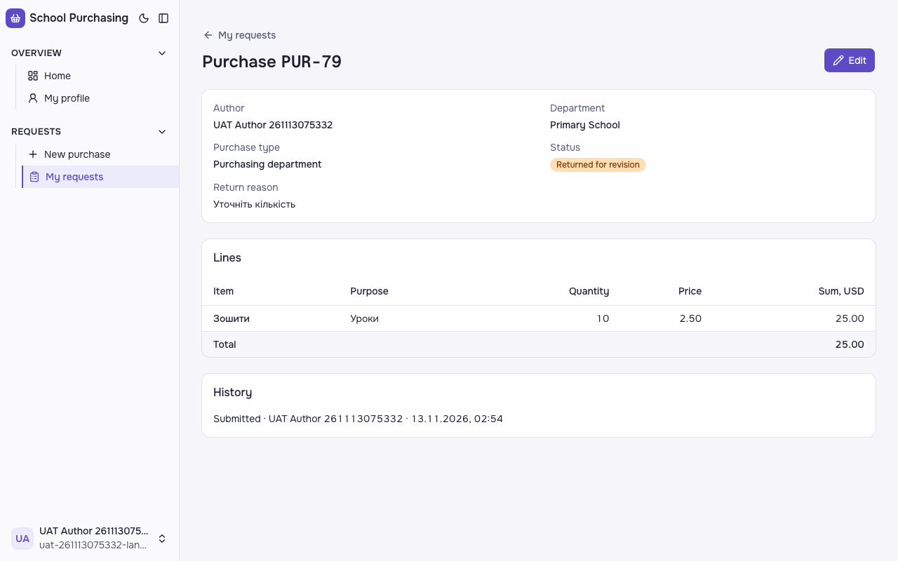
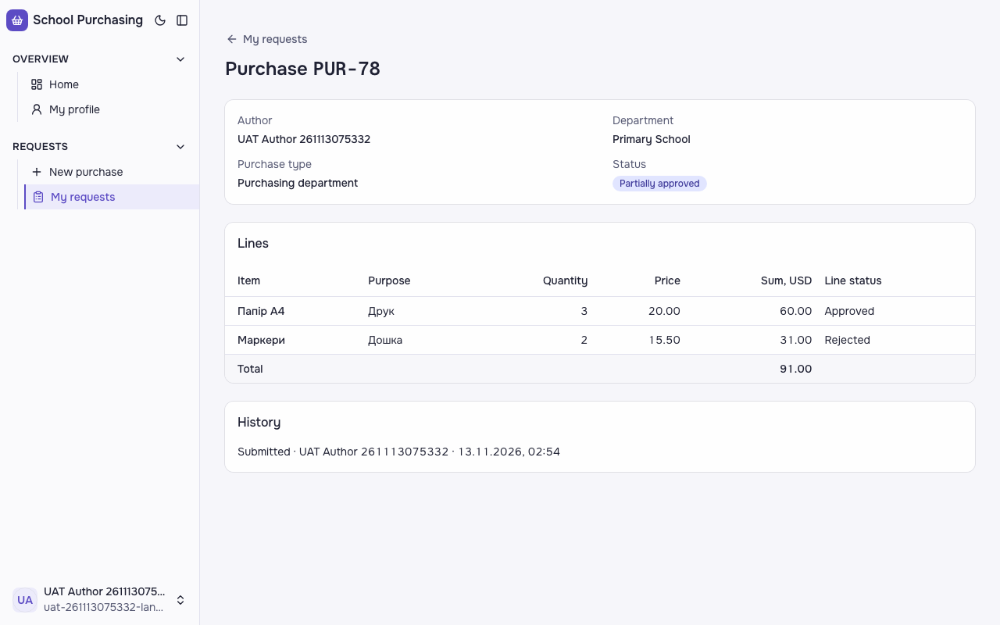

**Кроки:** ✔ Дано: заявки зі статусом «Частково схвалено» і «Повернено на доопрацювання» → ✔ Коли: їх показано у списку «My requests» автора → ✔ Тоді: статус підписано текстом «Partially approved» чи «Returned for revision» відповідно, а не лише кольором. → ✔ Коли: заявку «Повернено на доопрацювання» показано на сторінці заявки → ✔ Тоді: статус підписано текстом «Returned for revision», а не лише кольором. → ✔ Коли: заявку «Частково схвалено» показано на сторінці заявки → ✔ Тоді: статус підписано текстом «Partially approved», а не лише кольором.

**Агент (claude-haiku-5-5, PASS):** На кадрі списку «My requests» видно обидва статуси з текстом: «Returned for revision» (PUR-79) і «Partially approved» (PUR-78). На сторінках заявок PUR-79 і PUR-78 статус також підписано текстом «Returned for revision» і «Partially approved» відповідно, а не лише кольором. Частину «в історії» не оцінював, бо за журналом вона не з кадрів; у розділі History на кадрах є лише запис «Submitted».

**Цитати агента, звірені зі сторінкою (aria):**
- «Returned for revision» — є на сторінці
- «Partially approved» — є на сторінці
- «Returned for revision» — є на сторінці
- «Partially approved» — є на сторінці

**Правило:** R6: перевірки, агент і цитати збігаються

**Відео:** `test-results/artifacts/purchase-history-схвалювач-38e00-списку-й-на-сторінці-заявки-chromium/video.webm` · **траса:** `test-results/artifacts/purchase-history-схвалювач-38e00-списку-й-на-сторінці-заявки-chromium/trace.zip` (не в git)

**Рішення PM:** ☐ приймаю · ☐ відхилення від вимог (issue «Відхилення від вимог: AC-LANG-09 — …») · @login: ____

## Як читати підсумок

- **PASS** — автоматичні перевірки пройшли, агент-рецензент погодився з кадром, а кожну його цитату знайдено на сторінці.
- **FAIL** — впала автоматична перевірка. Агент цього не перекриває: невидимі вади (буфер обміну, база) він на кадрі не побачить.
- **NEEDS-HUMAN** — перевірки зелені, але агент не погодився або його цитати немає на сторінці. Часто це слабкий тест або розбіжність між текстом AC і тестом — питання до PM, а не обов'язково вада продукту.

Правила: R1: перевірка впала — FAIL завжди, агент не перекриває; R2: немає вердикту агента або кадру; R3: перевірки пройшли, агент не погоджується — вирішує людина; R4: цитати агента немає на сторінці (aria) — не підтверджено; R5: помилка сторінки або 5xx під час сценарію; R6: перевірки, агент і цитати збігаються.
