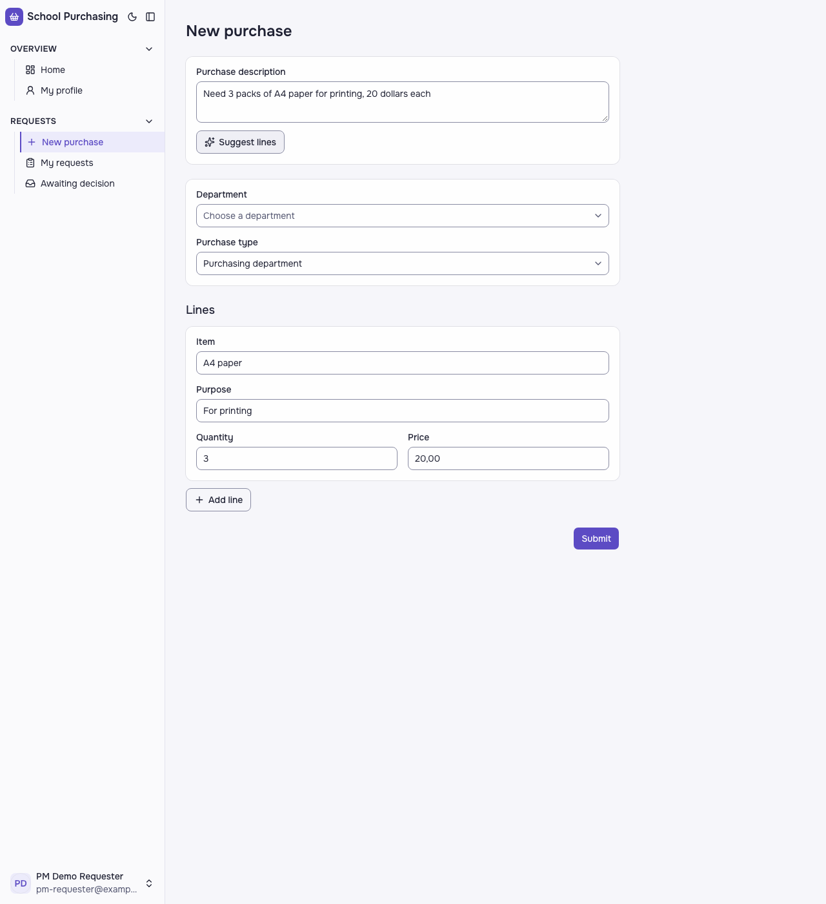
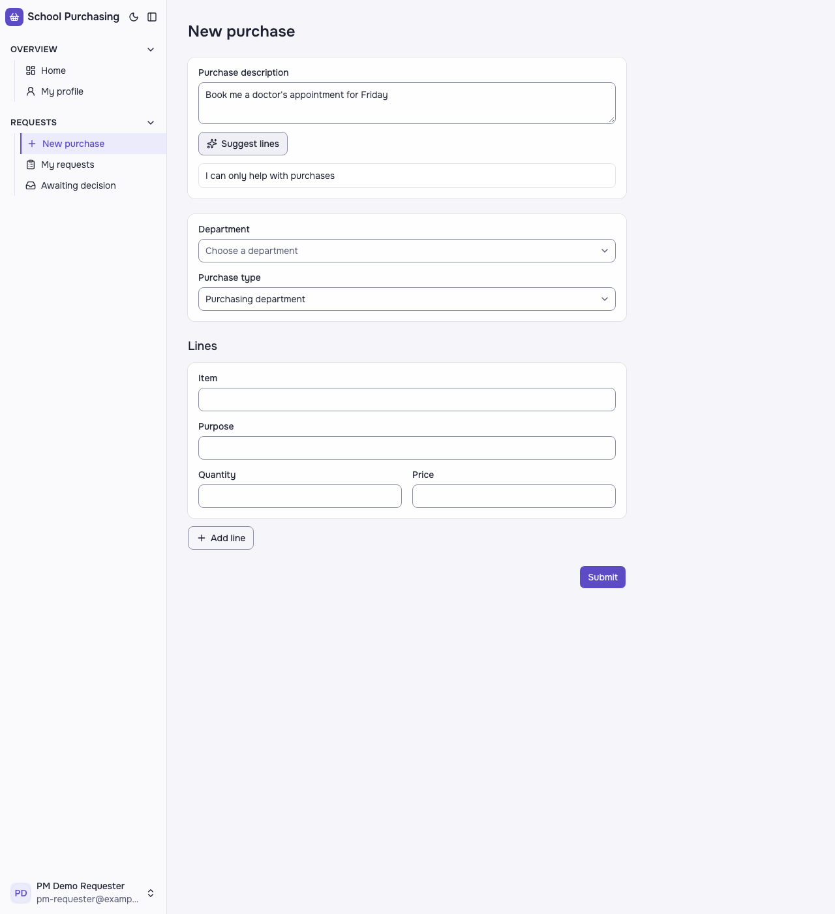

# Звіт UAT — 16.11.2026

- **Застосунок:** https://therapy-scheduling-ten.vercel.app (/api/health: коміт `b8dfdde`)
- **Код тестів:** `HEAD` @ `b8dfdde`
- **Прогін:** 16.11.2026, 16:27 (Київ), Playwright 40.2 с; AC: 2 — PASS 1, FAIL 0, NEEDS-HUMAN 1
- **Рецензент:** `claude-haiku-5-5`; суперечки → `claude-sonnet-5-5`. Разом за розбір: $0.0395 (ціни API; за підпискою — у межах ліміту плану)
- **Прибирання:** синтетичних uat-*@example.test видалено 0, лишилось 0, їхніх рядків, що лишились: 0
- **Відео й траси:** не в git — `test-results/` локально або артефакт CI; трасу відкриває `npx playwright show-trace <trace.zip>`

| AC | Перевірки | Агент | Підсумок | Чому | Playwright | Розбір |
|---|---|---|---|---|---|---|
| AC-AI-01 | пройшли | Haiku: PASS, Sonnet: PASS | **NEEDS-HUMAN** | R4: цитати агента немає на сторінці (aria) — не підтверджено | 10.4 с | $0.0374, 19.0 с |
| AC-AI-02 | пройшли | Haiku: PASS | **PASS** | R6: перевірки, агент і цитати збігаються | 5.4 с | $0.0022, 7.3 с |

## AC-AI-01 — NEEDS-HUMAN

**Тест:** AC-AI-01: опис «Need 3 packs of A4 paper for printing, 20 dollars each» — один рядок у формі (A4 paper, For printing, 3, 20.00), закупівлю ще не подано

**Критерій** (requirements/71-ai-proponuie-riadky-zakupivli.md):

> AC-AI-01: Дано працівник 1 відкрив форму нової закупівлі. Коли він вставляє опис «Need 3 packs of A4 paper for printing, 20 dollars each» і натискає «Suggest lines». Тоді він бачить один рядок: назва «A4 paper», мета «For printing», кількість 3, ціна 20.00, а закупівлю ще не подано.

**Кроки:** ✔ Дано: працівник 1 відкрив форму нової закупівлі → ✔ Коли: він вставляє опис «Need 3 packs of A4 paper for printing, 20 dollars each» і натискає «Suggest lines» → ✔ Тоді: він бачить один рядок: назва «A4 paper», мета «For printing», кількість 3, ціна 20.00, а закупівлю ще не подано.

**Агент (claude-sonnet-5-5, PASS):** На кадрі форма «New purchase» з одним рядком у «Lines»: Item «A4 paper», Purpose «For printing», Quantity 3, Price «20,00» (допустима локаль). Поле опису містить вихідний текст, форма ще не подана (видно кнопку Submit).

Haiku сказав PASS, тож розбір повторив Sonnet; рішення агента — за Sonnet.
Чому Haiku: PASS, але цитат немає на сторінці: «Item A4 paper», «Purpose For printing», «Quantity 3», «Price 20,00»

**Цитати агента, звірені зі сторінкою (aria):**
- «New purchase» — є на сторінці
- «Lines» — є на сторінці
- «A4 paper» — є на сторінці
- «For printing» — є на сторінці
- «3» — є на сторінці
- «20,00» — НЕМАЄ на сторінці
- «Need 3 packs of A4 paper for printing, 20 dollars each» — є на сторінці

**Правило:** R4: цитати агента немає на сторінці (aria) — не підтверджено

**Відео:** `test-results/artifacts/purchase-assistant-AC-AI-0-f5a2b-0-00-закупівлю-ще-не-подано-chromium/video-2.webm` · **траса:** `test-results/artifacts/purchase-assistant-AC-AI-0-f5a2b-0-00-закупівлю-ще-не-подано-chromium/trace.zip` (не в git)

**Рішення PM:** ☐ приймаю · ☐ відхилення від вимог (issue «Відхилення від вимог: AC-AI-01 — …») · @login: ____

## AC-AI-02 — PASS

**Тест:** AC-AI-02: опис «Book me a doctor's appointment for Friday» — «I can only help with purchases», рядків у формі не додано

**Критерій** (requirements/71-ai-proponuie-riadky-zakupivli.md):

> AC-AI-02: Дано працівник 1 відкрив форму нової закупівлі. Коли він вставляє опис «Book me a doctor's appointment for Friday» і натискає «Suggest lines». Тоді він бачить повідомлення «I can only help with purchases», а рядків у формі не додано.

**Кроки:** ✔ Дано: працівник 1 відкрив форму нової закупівлі → ✔ Коли: він вставляє опис «Book me a doctor's appointment for Friday» і натискає «Suggest lines» → ✔ Тоді: він бачить повідомлення «I can only help with purchases», а рядків у формі не додано.

**Агент (claude-haiku-5-5, PASS):** На кадрі в полі опису введено «Book me a doctor's appointment for Friday», і під кнопкою «Suggest lines» з'явилося повідомлення «I can only help with purchases». У розділі «Lines» видно один рядок із порожніми полями Item, Purpose, Quantity і Price, нижче розташовані лише «Add line» і «Submit».

**Цитати агента, звірені зі сторінкою (aria):**
- «I can only help with purchases» — є на сторінці
- «Lines» — є на сторінці
- «Item» — є на сторінці
- «Purpose» — є на сторінці
- «Quantity» — є на сторінці
- «Price» — є на сторінці
- «Add line» — є на сторінці
- «Submit» — є на сторінці

**Правило:** R6: перевірки, агент і цитати збігаються

**Відео:** `test-results/artifacts/purchase-assistant-AC-AI-0-47cb5-s»-рядків-у-формі-не-додано-chromium/video.webm` · **траса:** `test-results/artifacts/purchase-assistant-AC-AI-0-47cb5-s»-рядків-у-формі-не-додано-chromium/trace.zip` (не в git)

**Рішення PM:** ☐ приймаю · ☐ відхилення від вимог (issue «Відхилення від вимог: AC-AI-02 — …») · @login: ____

## Як читати підсумок

- **PASS** — автоматичні перевірки пройшли, агент-рецензент погодився з кадром, а кожну його цитату знайдено на сторінці.
- **FAIL** — впала автоматична перевірка. Агент цього не перекриває: невидимі вади (буфер обміну, база) він на кадрі не побачить.
- **NEEDS-HUMAN** — перевірки зелені, але агент не погодився або його цитати немає на сторінці. Часто це слабкий тест або розбіжність між текстом AC і тестом — питання до PM, а не обов'язково вада продукту.

Правила: R1: перевірка впала — FAIL завжди, агент не перекриває; R2: немає вердикту агента або кадру; R3: перевірки пройшли, агент не погоджується — вирішує людина; R4: цитати агента немає на сторінці (aria) — не підтверджено; R5: помилка сторінки або 5xx під час сценарію; R6: перевірки, агент і цитати збігаються.
